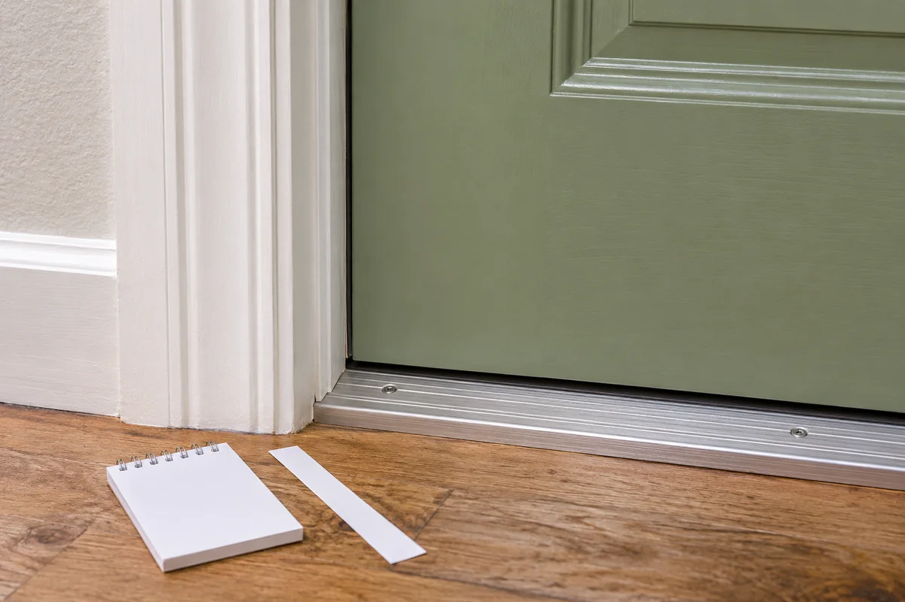

The floor by your front door feels cold. Before buying a sweep or sticking foam to the frame, find out where the draft is most noticeable. A note about one bottom corner gives maintenance a better starting point than “the whole door is drafty.”

Use this check from inside your rental. You'll need a short strip of plain paper, a phone or notebook, and a few minutes when the door can stay closed between observations. Leave the door and its hardware as they are.

## Check the door as you normally use it

Clear shoes and mats away from the swing. Close the door until it latches normally. If it scrapes, springs back, or needs a push to latch, record that first. Report trouble closing or latching directly to maintenance before trying the paper check. Leave any closer, seals, and threshold in place.

Look along the top, hinge side, latch side, and threshold. Note any visible daylight, a loose fit, or a missing section of seal. The Department of Energy's installer guide identifies daylight and a loose fit on exterior doors as clues to air leakage. For a door facing an interior hallway, look for light from the hall if it's visible. Darkness on the other side can hide a gap. [DOE exterior-door job aid](https://www.energy.gov/sites/default/files/2024-07/11-1_install-weatherstripping-on-exterior-door.pdf)

Look from both standing height and near the floor. At the bottom, record the left corner, middle, and right corner separately. If the door has a sweep, note where it appears to meet the threshold and where you can see an opening. Take a wide photo to establish the location and a close photo of the spot you want to describe.

<figure class="article-inline-image">

<figcaption>Check the two bottom corners separately. This generated scene illustrates the area to inspect.</figcaption>
</figure>

## Compare two points with the same paper

The Department of Energy suggests closing a door on a piece of paper and checking whether it pulls out easily. Try this at two reachable points along the latch side where a strip can sit across the seal, clear of the latch and lock hardware. Keep your fingers out of the closing edge and never force the door. Skip the check if you cannot place and retrieve the strip comfortably. [DOE home energy assessment guide](https://www.energy.gov/sites/default/files/2021-08/ES-Home%20Energy%20Assessments_080221.pdf)

With the door latched, gently pull the strip. Record whether it slides freely or meets resistance. Open the door to remove the strip if it catches. Repeat with the same paper at the second point, using the same closing routine. This comparison can suggest which location needs attention. It gives no airflow rate, and a spot that grips the paper can still leak under other conditions.

Keep the floor and doorway clear during the check and afterward. If this door opens to a shared hallway or has a closer or a fire label, let building staff determine which parts can be repaired or replaced. Avoid taping the gaps shut or leaving a loose stopper in the escape route. [U.S. Fire Administration escape planning guidance](https://www.usfa.fema.gov/prevention/home-fires/prepare-for-fire/home-fire-escape-plans/)

## Record what you observed

Start with one closed-door check. If the draft only shows up on certain days, describe the conditions when you feel it, such as a windy morning or a particular time of day. Add a second observation if it helps explain an intermittent problem, without delaying a report about a door that won't latch.

| Location | Example observation | Your note |
|---|---|---|
| Bottom, latch-side corner | Narrow line of daylight. Draft felt near the floor. | Where the light or draft starts and ends |
| Latch edge, below the handle | Paper slides out easily. | How the strip pulls at the first point |
| Latch edge, above the handle | Same strip meets resistance. | How the strip pulls at the second point |
| Normal operation | Door closes and latches without a push. | Any scraping, sticking, or latching trouble |

Here is a hypothetical maintenance note using that record:

> The entry door latches normally. On a windy morning I felt cold air near the bottom corner on the handle side, where there is a narrow line of daylight. A paper strip slid out easily below the handle and met resistance higher up. I have attached a photo of the bottom corner. Could you check the fit and existing seals?

## Let the report guide the next step

Send the note and photos through your building's maintenance channel. Ask staff to check the fit and seals before choosing a product. DOE's installer checklist calls for maintaining normal operation when adding weatherstripping or a sweep. If management proposes a separate optional update, share the exact product and location through the building's approval process. [DOE installer checklist](https://www.energy.gov/sites/default/files/2024-07/11-1_install-weatherstripping-on-exterior-door.pdf) and [our rental update request guide](/articles/ask-landlord-permission-rental-update/)

If a mat is part of the problem, check its position and thickness separately. That will help you keep the floor usable while maintenance looks at the door. [Entryway rug clearance guide](/articles/entryway-rug-door-clearance/)
