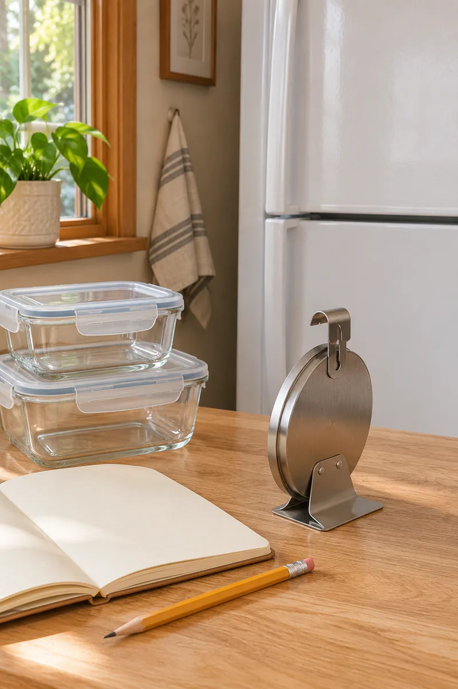

Making room for holiday groceries is only part of preparing a small refrigerator. Check its temperature before the shopping trip, while you still have time to review the controls or arrange service. A shelf that holds all your containers still needs to keep the food cold.

FDA recommends using an appliance thermometer to monitor the refrigerator and keeping it at **40°F or below**. A number on a control dial gives you a setting to record. Use a temperature measurement to check the storage conditions. [FDA refrigerator thermometer guidance](https://www.fda.gov/food/buy-store-serve-safe-food/refrigerator-thermometers-cold-facts-about-food-safety)

## Set up the thermometer before you need the space

Use an appliance thermometer intended for refrigerator temperatures. Read its setup and use instructions, including whether it stands, hangs, or uses a separate sensor. Keep its model and instructions with your appliance information so another household member can use it consistently.

Find the refrigerator's manual as well. Note the current control setting and whether a display reports a selected setting or a measured temperature. Our [home product manual guide](/articles/organize-home-product-manuals/) helps you locate the right instructions for the model in your kitchen.

For its cold-storage check, FDA advises placing a thermometer in the middle of the refrigerator and checking after **five to eight hours**. Follow the thermometer's instructions for a suitable position and a stable reading, and the refrigerator manual for any model-specific measurement method. Keep the door closed during the waiting period except for normal necessary use. [FDA cold-storage temperature check](https://www.fda.gov/food/buy-store-serve-safe-food/what-you-need-know-about-preventing-listeria-infections)

## Write the reading with its conditions

Record the date, time, thermometer location, and temperature in Fahrenheit. Add the control setting and anything that changed recently, such as loading groceries or rearranging a shelf. Use the same location for a follow-up comparison and note if you move the thermometer.

Read it promptly when opening the door, rather than leaving the door open while you write a detailed note. For a remote-display model, follow its instructions for reading the sensor. Keep the record outside the refrigerator where others can find it.

| Date and time | Reading | Thermometer location | Conditions or change | Next action |
|---|---|---|---|---|
| Your first check | Record °F | Name shelf and position | Current control setting; recent loading | Compare with 40°F limit |
| Your follow-up | Record °F | Same position, or explain move | Note any control or shelf change | Record next check or service request |
| After the grocery trip | Record °F after the appropriate settling period | Record actual position | Food load and any change to airflow | Review the new reading |

## Interpret a simple example

In a hypothetical kitchen, a settled reading before shopping is **38°F**. After the grocery trip and the appropriate settling period, the same thermometer in the same position reads **39°F**. Both recorded readings are below FDA's 40°F limit. The household continues checking and keeps the containers spaced so cold air can circulate.

The example gives you a way to document observations. Two readings leave gaps between them, so keep those gaps visible in the record. If you change the thermostat or move the thermometer, write that down instead of attributing a new reading only to the groceries.

<figure class="article-inline-image">

<figcaption>Keep a dated record of readings and changes. This generated illustration shows the supplies, not an actual temperature measurement.</figcaption>
</figure>

## Resolve a warm reading promptly

If the reading is above 40°F, check the thermometer setup and refrigerator instructions promptly. Review the door closure and any blocked vents. FDA cautions against overpacking because cold air needs room to circulate. Follow the appliance manual for control adjustments and the required stabilization period. If it cannot maintain an appropriate temperature, arrange service or contact rental maintenance with the readings and model details. [FDA airflow and temperature guidance](https://www.fda.gov/food/buy-store-serve-safe-food/refrigerator-thermometers-cold-facts-about-food-safety)

Protect the food while resolving the appliance problem. Move food that is still safe to another refrigerator that maintains 40°F or below. FDA's emergency guidance says to discard perishables such as meat, poultry, fish, eggs, and leftovers that have been above 40°F for two hours or more. FDA advises discarding food when you cannot establish how long it has been too warm. A later cold reading does not establish the earlier temperature history. [FDA emergency food-safety guidance](https://www.fda.gov/food/food-safety-during-emergencies/power-outages-key-tips-consumers-about-food-safety) and [FDA food-safety guidance](https://www.fda.gov/food/buy-store-serve-safe-food/refrigerator-thermometers-cold-facts-about-food-safety)

Once the refrigerator is maintaining the right temperature, plan its usable space with the groceries in place. Our [small-fridge leftovers guide](/articles/make-fridge-room-for-thanksgiving-leftovers/) rehearses the actual containers and reserves freezer space before the meal. Keep the temperature record as part of that preparation and continue checking after the holiday rush.
