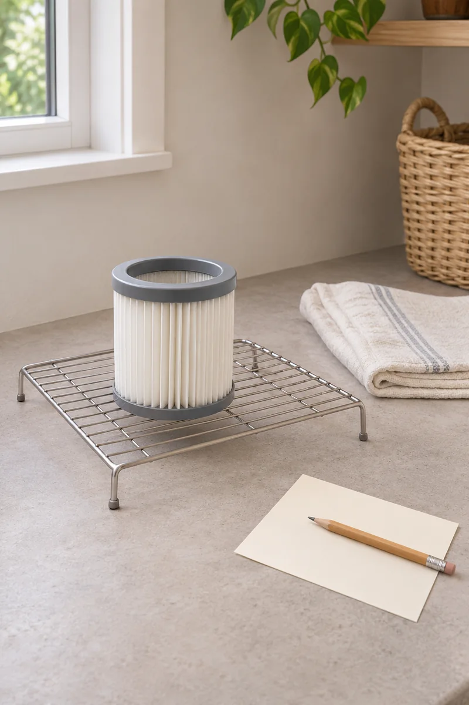

Before putting a dusty vacuum filter under the faucet, identify the part. A vacuum can have more than one filter, and instructions for the dust container may not apply to the filter sitting inside it.

Use this routine to make a care plan for a vacuum you already own. You'll finish with a short record of which parts can be washed, which need another method, and when the machine can go back into use. The generated photographs illustrate the planning and drying space; they are not a tested project or pictures of the specific models discussed below.

## Match the instructions to the vacuum and the part

Find the full model identifier and open the manufacturer's matching U.S. manual or support page. Check any model suffix or version shown in the document. Our [home product manual guide](/articles/organize-home-product-manuals/) explains how to keep that match with the machine's records.

Follow the manual's shutdown and power-disconnection procedure before removing an owner-accessible part. Use its diagrams to identify each filter and the permitted release method. Stop if a part doesn't release as described; don't dismantle the motor or battery housing to investigate.

Give each filter its own row in your notes. Use the maker's name for it, such as prefilter, fine dust filter, or exhaust filter, together with its location. A photo taken before removal can help you remember the arrangement, but the instructions determine how it goes back.

## Sort the parts by permitted care

For each identified part, find an explicit instruction: wash, clean by a specified dry method, replace, or leave alone. Record an unclear instruction as unresolved. Similar color, shape, or pleated material doesn't establish washability.

Two manufacturer examples show why the distinction matters:

- The [Dyson V8 SV10 manual linked here](https://www.dyson.com/content/dam/dyson/maintenance/user-guides/en_US/vacuumcleaners/cordlessstickvacuums/sv10/without-soft-roller/229602-01.pdf) describes washing **Filter B** under cold running water, then leaving it upright to dry completely for a minimum of 24 hours.
- [Miele's Triflex support page](https://www.mieleusa.com/support/customer-assistance/cordless_stick_vacuum_cleaner-1328/all/cleaning_performance_is_reduced_triflex-92398353803) gives separate procedures for different versions. For **HX1 Facelift and HX2**, it prohibits water on both the fine dust filter and prefilter. The page permits water and mild dish soap for the dust container, a separate component.

These are examples of different care requirements, not interchangeable cleaning instructions. Use the section covering your actual machine and part. If the exact match remains unclear, ask the manufacturer before cleaning it.

## Reserve the drying space before washing

If washing is permitted, read the whole procedure first. Note water temperature, whether any cleaning product is allowed, the handling method, drying orientation, and the minimum drying time. Permission to rinse a filter doesn't mean every detergent or cleaning tool is acceptable.

Choose a clean, undisturbed spot with the airflow and positioning the maker requires. In a small home, reserve that space before starting, so a filter won't have to be moved back into the vacuum to free the counter.

Dyson's [filter-care guidance](https://www.dyson.com/support/vacuum-cleaners/cordless/filter-care) requires complete drying before refitting and warns that moisture can damage the motor. It also rules out a tumble dryer, microwave, or naked flame for drying. Follow your model's instructions rather than trying to shorten the wait with improvised heat.

<figure class="article-inline-image">

<figcaption>Reserve an undisturbed drying spot only for a part confirmed as washable. This generated scene does not establish the pictured filter's compatibility or care instructions.</figcaption>
</figure>

## Make a filter-care card

| What to record | Your entry |
|---|---|
| Vacuum identity | Exact model/version and official instruction link |
| Part identity | Manufacturer's name, location, and part number if provided |
| Permitted care | Wash, specified dry method, replace, or unresolved |
| Procedure details | Water temperature, allowed products/tools, handling and orientation |
| Timing | Cleaning time, minimum drying interval, and next dryness check |
| Return to use | Required condition, refitting steps, and next care check from the manual |

Keep this card with the saved instructions. If a replacement is required, confirm the compatible part rather than shopping from a similar-looking photograph. This record concerns the vacuum; a home's heating-system filter has its own specifications. See our separate [HVAC replacement filter guide](/articles/match-replacement-hvac-filter-size/) for that task.

## Plan a check time, not a guaranteed finish

Here is a hypothetical household schedule for a confirmed washable filter whose instructions require complete drying and at least 24 hours.

The household finishes washing at 9 a.m. Saturday. Sunday at 9 a.m. is the first planned check, exactly 24 hours later. If the filter is still damp, it stays out longer. The elapsed time alone doesn't make it ready. Plan the floor cleaning around that uncertainty.

Before refitting, check the required condition and follow the model's reassembly sequence. Keep the vacuum out of use while required filters are removed or not ready. If a part is damaged or its condition is uncertain, consult the maker's support instructions before using the machine.

Record what you actually did and set the next inspection from the manual's schedule or indicator guidance. A care card that distinguishes “washed and drying” from “ready and refitted” helps another household member avoid restarting the machine too soon.
