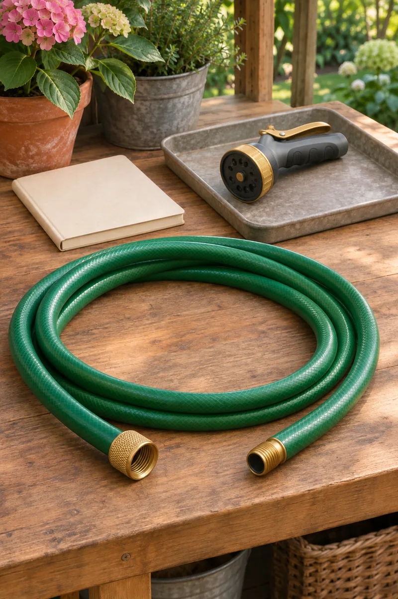

The hose can be the last thing left across a patio after the chairs and cushions move into storage. Give it a separate cold-weather task: disconnect it, drain it, and choose a place where the coil and nozzle will be easy to find again.

Plan this before freezing weather reaches your location. This guide covers an ordinary detachable garden hose that is still flexible and can be handled normally. For an expandable hose, automatic reel, or another specialty system, use the exact product's storage instructions before taking anything apart.

## Identify the hose and its storage place

Find any brand, model, and length marking on the hose or its packaging. Read the storage and care directions for the hose and nozzle. Keep the instructions with your garden records. Our [home product manual guide](/articles/organize-home-product-manuals/) offers a way to connect each item with the right document.

Choose an actual destination before moving the coil. Gilmour recommends draining and storing its hoses in a garage, shed, or basement before temperatures approach freezing, and keeping hoses out of sunlight. Check your hose maker's requirements against the conditions in your chosen space. [Gilmour hose storage guidance](https://gilmour.com/house-hose-maintaining-repairing-longer-life/)

Make room for the entire coil and its fittings. Keep the floor, doorway, shared routes, and other stored items accessible. A winter location should let you retrieve the hose without pulling it from beneath a heavy stack.

## Turn off the water and disconnect

Turn off the outdoor faucet. With the nozzle pointed toward a suitable drainage area, release the remaining pressure according to the hose and nozzle instructions before disconnecting. GARDENA advises turning off the tap after use and avoiding leaving a hose under pressure. [GARDENA hose-use instructions](https://www.gardena.com/au/c/discover/gardening/magazine/hose-first-time-use-instructions)

Remove the hose from the faucet and detach the nozzle and other removable watering accessories as their instructions allow. Keep any small removable parts together. If a connection will not release normally or the faucet is damaged or leaking, arrange appropriate maintenance rather than forcing the fitting.

Illinois Extension recommends removing and draining hoses from outdoor spigots. It explains that an attached hose can retain water and allow freezing to progress toward the spigot. The faucet and its supply need their own winter preparation, suited to that installation. In a rental or shared building, confirm who handles that work. [Illinois Extension winter guidance](https://extension.illinois.edu/blogs/good-growing/2020-11-26-how-winterize-outdoor-plumbing-irrigation-hoses-spigots)

## Drain before making the final coil

Unroll the hose along a clear route where its water can drain without creating a slippery walking surface. Keep it away from shared paths while working. With both ends open, progressively raise sections so the water moves toward an outlet. Gilmour describes lifting the hose over the shoulder to drain it before coiling. Use a manageable section and get help if the hose is heavy. [Gilmour draining method](https://gilmour.com/house-hose-maintaining-repairing-longer-life/)

Follow the maker's directions for any cleaning or flushing, then complete the draining step before storage. Let removable accessories drain as their instructions require. Wipe away exterior dirt so you can see the hose and fittings clearly.

Check for a crushed connector, cracking, or another issue you noticed during use. Record it with a photo while it is visible. Keep an unresolved repair on the spring checklist so the hose does not return to service with the same forgotten problem.

<figure class="article-inline-image">

<figcaption>Give the hose and its removable accessories identifiable storage places. This generated scene illustrates the arrangement.</figcaption>
</figure>

## Store the coil and nozzle as a pair

Coil the hose without sharp folds, following its product directions. Gilmour describes using a suitable hanger, bowl, or reel to organize a hose. Use a support that suits your actual hose and location. Keep the coil stable and the fittings easy to see. [Gilmour storage options](https://gilmour.com/house-hose-maintaining-repairing-longer-life/)

Put the drained nozzle and permitted removable parts in a nearby tray or other suitable holder. Label their location in your record. Our [patio hand-tool storage guide](/articles/small-patio-hand-tool-storage/) can help you keep these small items accessible without mixing them into an unmarked pile.

Imagine a household with one hose, one spray nozzle, and a sprinkler attachment. The hose goes on the left utility shelf, and the accessories go in a tray beside it. One connector has a damaged edge, so the household adds its photo to the repair note and records that the item needs attention before use. This is a hypothetical storage example, not a product test.

| Item or task | What to record | Check before using again |
|---|---|---|
| Hose | Model, length if known, storage location | Care instructions and visible condition |
| Spray nozzle | Where it is stored; care completed | Connection and operation |
| Other removable attachments | Match each item to its holder | Any parts or instructions needed |
| Unresolved issue | Photo and a specific description | Appropriate repair or replacement completed |
| Outdoor faucet | Who handles winter preparation | Confirm the separate maintenance task |

If you take the hose out for a mild-weather watering session, repeat the draining and storage routine before the next freeze according to its instructions. Add its destination to your [small patio winter storage plan](/articles/small-patio-winter-storage-plan/) so the watering equipment is included alongside the furniture and cushions.
