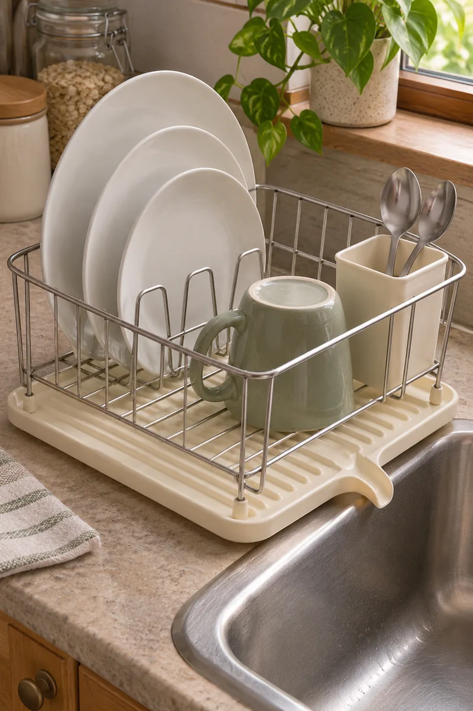

A dish rack can fit beside the sink and still leave you nowhere to prepare lunch. Plan the drying area with the kitchen in use: clean dishes need a stable place, water needs a destination, and the next meal needs some dry working space.

Start with your current rack, tray, or other suitable drying setup. Try one normal washing session before deciding whether the equipment needs changing. The useful question is where the dishes go between rinsing and being put away.

## Reserve the preparation space first

Clear the counter and put your usual cutting board where you comfortably use it. Leave enough room to work around it and reach the items you need. Note this area on a sketch or take a photo. Keep it available while planning the drying spot.

Place the rack near the sink where it can stand fully supported. Check its complete footprint, including a cutlery holder, tray, and any projecting spout. Open nearby drawers and cabinet doors. Reach the faucet and sink controls. Make sure you can remove a plate or glass without hitting the cabinet above it.

If drawer contents keep migrating onto the counter, our [small kitchen drawer guide](/articles/organize-small-kitchen-drawers/) can help give those tools an accessible home. Freeing that space may make a better drying position possible.

## Find out where the water goes

Look at the tray separately from the rack. Does it collect water for you to empty, or does it drain through an outlet? Follow the exact product's instructions for orientation and support. For a spouted tray, check that the outlet actually reaches the sink without leaving part of the setup unstable.

For example, Joseph Joseph describes a movable spout on its Extend Steel rack that directs water into the sink, along with raised ribs for draining glasses and bowls. Those features describe that model. Inspect how your own rack works before moving or extending parts. [Manufacturer's drainage description](https://us.josephjoseph.com/products/extend-steel-dishrack-stone)

During normal use, check for drips on the counter, at the sink rim, and underneath the tray. Empty a collecting tray as needed and clean and dry the surface beneath it. A tray hidden under dishes is easy to overlook, so include it in the return-to-normal routine.

## Try the dishes you actually wash

Use clean, dry items for an initial arrangement. Stand plates in the intended slots and use the designated areas for cups and utensils. Follow the rack's loading directions. Check that each item is stable and can be removed individually. Keep sharp tools in an appropriate protected position according to their instructions.

Include an awkward item from a typical meal, such as a mixing bowl, pan, or food-container lid. See how it changes access to the rest. If it occupies the whole rack, give it a separate drying stage instead of building a stack over the plates.

For food containers, match their intended lids before putting them away. Our [container-and-lid guide](/articles/organize-food-containers-match-lids/) helps you keep complete sets together after washing.

<figure class="article-inline-image">

<figcaption>Check the loaded rack and the tray's outlet together. This generated illustration shows a possible arrangement, not a tested product.</figcaption>
</figure>

## Plan a session around the available capacity

The American Cleaning Institute recommends starting with lightly soiled items, moving through plates and serving dishes, and ending with cookware. Its household guide includes both air drying and drying with a clean towel, depending on the item and your chosen method. Follow dishware and cookware care instructions when deciding how to handle each piece. [ACI hand-dishwashing guide](https://www.cleaninginstitute.org/cleaning-tips/dishes/washing-dishes-hand)

Imagine a household washing four plates, two mugs, a bowl, and a pan. In a hypothetical trial, the plates and mugs fit stably, but the bowl and pan cover the tray and prevent easy removal of the mugs. The household washes and rinses the first group, lets it dry, and puts it away before using the rack for the larger items. They schedule the second stage when the counter is available.

Another household may choose a suitable clean-towel drying method for an item it needs immediately. ACI advises changing a drying towel when it becomes damp. Choose a routine you can finish while keeping the clean items separate from dirty dishes. The example establishes no universal rack capacity or drying time. [ACI drying advice](https://www.cleaninginstitute.org/cleaning-tips/dishes/washing-dishes-hand)

| Check during your trial | What to record | Change to try |
|---|---|---|
| Working area | Can you still use the cutting board? | Move unrelated counter items first |
| Drainage | Where does water collect or leave? | Correct orientation using the instructions |
| Everyday load | Which pieces fit stably together? | Group a manageable washing stage |
| Awkward item | What does the bowl or pan block? | Plan a separate stage or suitable drying method |
| Put-away step | Are dry dishes staying in the rack? | Choose a regular time to clear it |
| Cleanup | Is the tray and counter beneath accessible? | Include them when finishing |

## Finish with an empty, clean drying area

Put dry dishes away and clean the rack and tray using their own care directions. ACI includes rinsing and wiping the dish drainer in its cleanup routine. Joseph Joseph's cited steel model specifies hand washing and drying, with restrictions on abrasive cloths and strong chemical cleaners. Check your exact model before choosing a cleaning method. [ACI cleanup guidance](https://www.cleaninginstitute.org/cleaning-tips/dishes/washing-dishes-hand) and [manufacturer care directions](https://us.josephjoseph.com/products/extend-steel-dishrack-stone)

If you intend to store the rack between sessions, check that it is clean, dry, and easy to retrieve. Finish by leaving the sink usable and restoring the preparation space. Repeat the trial after a larger meal to see which stage needs adjusting while the details are fresh.
