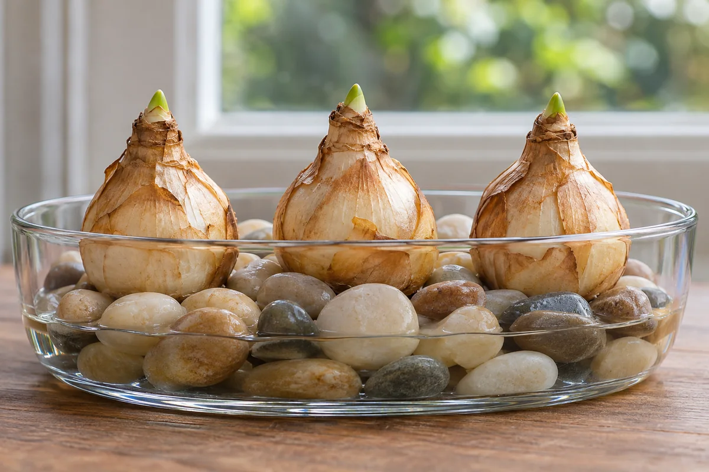

A bowl of paperwhites can bring flowers to a small apartment in winter. Pick a spot where you can see the waterline and reach the bowl without lifting it over furniture. Then use the bowl you have to work out how many bulbs to buy.

Look for firm, undamaged bulbs labeled **paperwhite narcissus** and sold for indoor forcing. Forcing means getting the bulbs to bloom indoors outside their usual season. Paperwhites can start without a chilling period. Check the label if you are considering a different daffodil or another spring bulb, since its preparation can differ. [Illinois Extension paperwhite guide](https://extension.illinois.edu/blogs/garden-scoop/2024-12-23-paperwhites-delicate-holiday-blooms-you-can-grow-indoors) and [Wisconsin Extension bulb selection guide](https://hort.extension.wisc.edu/articles/forcing-bulbs/)

## Find a place for the bowl before buying bulbs

A clear, watertight bowl with a flat base makes it easy to check the water without disturbing the stones. Test it with plain water over a sink first. Choose a stable, level surface that can handle the weight of the filled bowl. Leave enough room above it for the stems and space beside it to pour water slowly.

Paperwhites are toxic if eaten. Keep the bowl and any spare bulbs out of reach of children and pets, and store unused bulbs apart from food. Choose another plant if you cannot provide a spot they cannot access. [Poison Control on Narcissus](https://www.poison.org/articles/daffodils) and [ASPCA on paperwhites](https://www.aspca.org/pet-care/aspca-poison-control/toxic-and-non-toxic-plants/paper-white)

## Fit the bulbs and set the waterline

1. Add clean pebbles to the bowl and level the layer. Check the fit with the actual bulbs, flat ends down and tips up. Leave enough space that the bulbs sit apart without touching.
2. Tuck more pebbles around the bulbs until they stand upright. Leave their tops exposed.
3. Pour water slowly along the inside wall until it sits just below the bottoms of the bulbs. Look from the side at eye level. Keep the bulbs themselves out of the water and maintain that level as the roots grow down.

Wisconsin Extension's general water-forcing instructions recommend keeping water just below the bulbs. A clear bowl helps you check that point directly. If the bulbs sit at different heights, level their pebble supports before adding water so one waterline works for all of them. [Wisconsin Extension forcing guide](https://hort.extension.wisc.edu/articles/forcing-bulbs/)

<figure class="article-inline-image">

<figcaption>Check the bases of the actual bulbs from the side when setting the waterline. This is a generated illustration of the starting setup.</figcaption>
</figure>

## Watch the roots and plan the display

For rooting, the Wisconsin Extension paperwhite method starts the bowl in a cool, dark spot, around 45–50°F. This is the rooting stage after setup. Once roots have developed, move the bowl to a cool, sunny spot where you can still see and reach the waterline. Use the light log to compare candidate spots. [Wisconsin Extension paperwhite care](https://hort.extension.wisc.edu/articles/forcing-bulbs/) and [our houseplant light guide](/articles/check-window-light-before-buying-houseplants/)

As stems grow, check that the bulbs are still supported and the bowl stays stable. For tall varieties, follow supplier or extension guidance for support. Wisconsin Extension gives about three to five weeks from starting paperwhites to bloom as a general estimate. Use it to plan a window of time and choose a backup if the flowers are for a particular date. [Wisconsin Extension paperwhite care](https://hort.extension.wisc.edu/articles/forcing-bulbs/)

## Keep a simple record for your next bowl

Suppose you have a clear bowl about 7 inches across at the pebble surface and about 3 inches deep. Try the bulbs at the level where they will sit, since the opening can be wider than the usable base. If three bulbs fit comfortably but a fourth touches its neighbors, plant three. These dimensions describe a hypothetical bowl. Your bulb sizes and the shape of your vessel determine the fit.

| When | What to check | What to write down |
|---|---|---|
| Setup | Bulbs upright and apart, water just below their bases | Start date, bulb variety, and starting spot |
| Rooting | Waterline and visible roots | Date roots first appear and when you topped up |
| Moving the bowl | Bright spot and ability to reach the bowl | Move date and where it sits |
| First flowers | Opening date and whether stems stay upright | Elapsed days and what you would change next time |

After the first bowl, compare your timing with the published estimate. If you want flowers over a longer stretch, start another suitable batch later and keep a separate record for each. For plants you plan to keep outdoors through winter, use the [potted perennial winter guide](/articles/overwinter-potted-perennials-small-patio/) to make a separate plan for their conditions.
