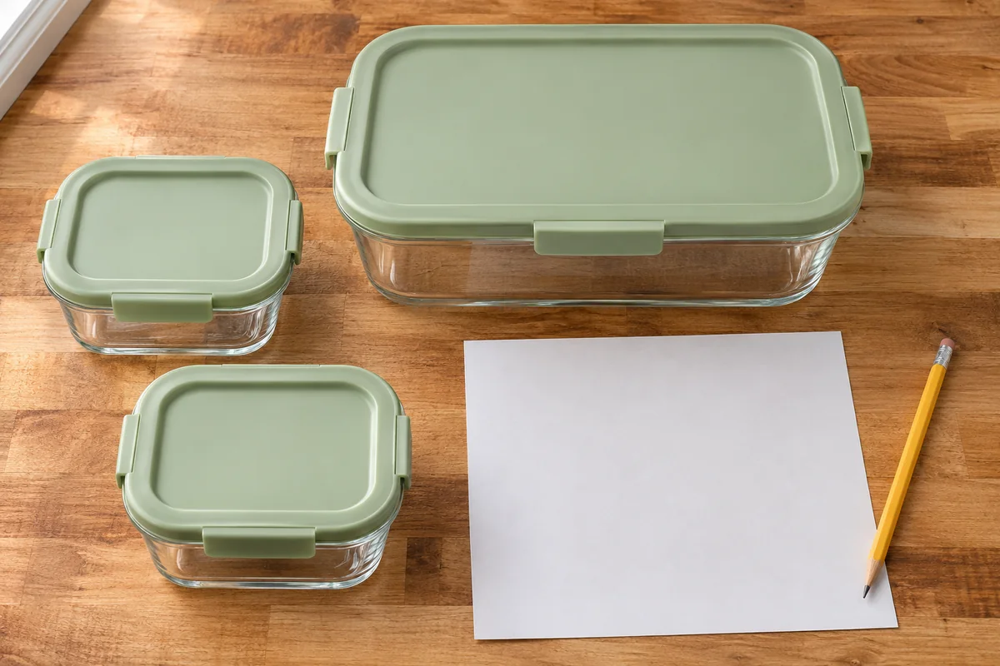

A serving dish can fit neatly on the Thanksgiving table and still take up most of a refrigerator shelf. Try the containers you will use for leftovers before the meal. A dry run with empty containers gives you time to find freezer space, reduce the batch, or use a different set of containers while the kitchen is quiet.

## Choose the shelf with the fridge loaded

Look at the refrigerator as it will be just before dinner. Leave room for the groceries that still need to stay cold. Move only items whose labels allow room-temperature storage. Use an appliance thermometer to check that the refrigerator is at **40°F or below** and the freezer is at **0°F or below**. Keep space around the food for cold air to circulate. Check your appliance instructions for shelf placement and vents. [FDA refrigerator guidance](https://www.fda.gov/food/buy-store-serve-safe-food/refrigerator-thermometers-cold-facts-about-food-safety)

Measure the free width, depth, and height of a reachable shelf area. Take the usable measurements inside any raised lip or side rail. Check the space in front of the containers as well, so you can lift one out without first removing everything in front of it.

## Try the actual containers, with their lids

Pull out clean, shallow containers and match each base to its intended lid. Use containers whose instructions allow the intended food temperature and freezer use if needed. Measure across the widest points, including tabs and handles. Our [guide to matching food containers and lids](/articles/organize-food-containers-match-lids/) can help you find complete sets before you begin.

Try them in one layer for the rehearsal so you can see the space around each container. Close the door gently and make sure the door shelves clear the lids. You can take a photo of the arrangement or draw it on the plan. Put the empty containers back on a clean counter so they're ready to fill.

<figure class="article-inline-image">

<figcaption>Match lids and assign each container a destination before the meal. This is a generated illustration of the planning step.</figcaption>
</figure>

## Give each dish a destination before serving

List likely leftovers by dish. Decide which portions you expect to eat soon and which to freeze. Make space in the freezer during the same rehearsal. If your fridge and freezer cannot hold the amount you expect, plan a smaller batch before cooking.

| Dish | Empty containers to try | Destination | Check before dinner |
|---|---|---|---|
| Sliced turkey | Two shallow covered portions | One refrigerator, one freezer | Both spots are ready and cold |
| Mashed potatoes | One shallow covered portion | Refrigerator | Can be removed without shifting the turkey |
| Stuffing | One shallow covered portion | Freezer | Container is suitable for freezing |
| Your extra dish | Write in the planned portions | Pick a spot now | Check the full arrangement with lids fitted |

In a hypothetical kitchen, there are **18 inches** of free shelf width. Three containers each measure **6 inches** across with the lid attached. They consume the full 18 inches side by side, leaving no lateral gap. The household moves one intended freezer portion to its reserved freezer spot and rehearses the other two on the shelf. The remaining width is available for spacing and lifting the containers out. Use your own measurements and check airflow with groceries in place. The example is a fit calculation, not a cooling test.

## Pack promptly and label the portions

Divide large amounts into shallow portions and cover them. Slice a large cut of meat or break down a whole bird into smaller portions for storage. Small portions of hot food can go straight into the refrigerator. If you're freezing portions, use the space you reserved. [FoodSafety.gov chilling guidance](https://www.foodsafety.gov/keep-food-safe/4-steps-to-food-safety) and [FDA hot food guidance](https://www.fda.gov/food/buy-store-serve-safe-food/refrigerator-thermometers-cold-facts-about-food-safety)

Refrigerate or freeze perishable leftovers promptly, within **two hours** of cooking or taking them out of hot holding. The limit is **one hour** if the surrounding temperature is above 90°F. Discard perishable food that exceeds those limits. Check the clock during long meals and put away the food you are done serving. [FoodSafety.gov leftover guidance](https://www.foodsafety.gov/blog/prevent-illness-c-perfringens)

Write the dish and date on each container. Plan to use promptly chilled refrigerated leftovers within **three to four days of cooking**, or freeze them within that period for longer storage. [FoodSafety.gov storage guidance](https://www.foodsafety.gov/blog/prevent-illness-c-perfringens) Put the portions you plan to eat first near the front where you will see them. The next time you host, look at which dishes filled more containers than expected and adjust the plan while those details are fresh.
