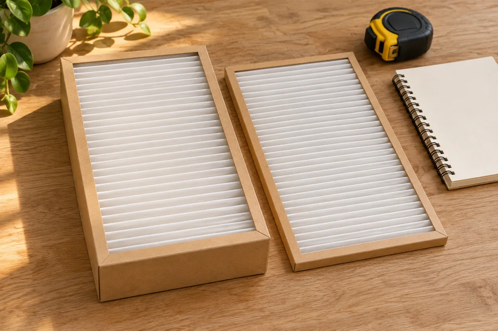

The box says 16 × 25 × 4, just like your last filter. Before you order a multipack, look for a second set of dimensions in the listing. A fraction of an inch in frame thickness can change whether the filter slides into its slot.

This guide helps you shop for a replaceable filter in a ducted home heating or cooling system. Start with the instructions for your equipment and filter holder. A return grille, a filter cabinet, and a filter inside a unit can have different requirements.

## Find the instructions for the filter location

Record the model of the equipment and, if it has a separate filter cabinet, the cabinet model too. Look for the specified replacement part or size, the filter type, and any limit on efficiency or airflow resistance. A service invoice or the building's maintenance staff may identify the holder if the equipment manual covers several installations. Our [home product manual guide](/articles/organize-home-product-manuals/) shows how to check that a document covers your exact model.

Use the system's instructions to identify any access panel intended for household filter changes. Follow that procedure, including shutdown directions, if you are responsible for the change. If maintenance handles the filter, ask for the approved replacement specification. Use the same approach if the holder is inaccessible or the instructions call for service access.

## Record both sizes in inches

**Nominal size** is the name commonly printed on the package. **Actual size** is the physical length, width, and thickness of the frame. Trane describes the distinction, and 3M advises comparing the actual frame because nominal labels can vary across brands or systems. Check all three dimensions and the seller's stated order. [Trane filter sizing guide](https://www.trane.com/residential/en/products/indoor-air-quality/filters/) and [3M Filtrete FAQs](https://www.filtrete.com/3M/en_US/filtrete/about-us/faq/)

If you can safely access a current filter, photograph the edge label and note any part number. Compare it with the approved specification. An existing filter may be the wrong one, especially if it rattles, leaves a gap, or shows crushed edges. If the label lacks actual dimensions, measure the full outside frame of a known suitable filter or look up the part number. Ask the equipment maker, a technician, or management if the requirements are still unclear.

<figure class="article-inline-image">

<figcaption>Compare the thickness of the whole frame. These illustrated filters are unbranded examples.</figcaption>
</figure>

## Check a candidate before buying a pack

Imagine a filter cabinet that calls for a particular part. Its approved replacement measures **15½ × 24½ × 3¾ inches** and is sold under a **16 × 25 × 4** nominal label. A candidate has the same label, but its actual measurements are **15½ × 24½ × 4¼ inches**. That makes it **½ inch thicker** than the approved replacement. With no stated allowance for that thickness, the shopper sets it aside and checks the cabinet maker's approved options. These are hypothetical dimensions, not specifications for every 16 × 25 × 4 holder.

EPA recommends a filter that sits snugly, with no need to bend or crush it. Filter efficiency is a separate decision. EPA recommends MERV 13 for a residential HVAC upgrade, or as high a rating as the system fan and slot can accommodate. Confirm compatibility with the manufacturer or a qualified HVAC technician before changing the rating. [EPA guide to air cleaners and HVAC filters](https://www.epa.gov/indoor-air-quality-iaq/guide-air-cleaners-home)

| What to record | Where to check | What to do if it is missing |
|---|---|---|
| Filter location and holder model | Manual, label, or service record | Ask who services that holder |
| Approved part or filter requirements | Manufacturer instructions or maintenance | Resolve the specification before ordering |
| Nominal and actual dimensions | Filter label or seller's specification | Ask for all three outside frame measurements |
| Efficiency and system limits | Equipment guidance or HVAC technician | Confirm what the system can accommodate |
| Last change and next check | Your maintenance record and the manual | Create a reminder based on the stated schedule |

## Save the information you will need again

Once you have a documented match, save the part number, actual dimensions, and the instructions for that filter location. If you perform an authorized change, follow the manual for placement and airflow direction and record the date. Follow the manufacturer's inspection and replacement schedule. A photo of the next box beside your record makes a future reorder easier to verify. [EPA filter replacement guidance](https://www.epa.gov/indoor-air-quality-iaq/guide-air-cleaners-home)

If your immediate concern is a cold spot at an entry door, document where and when you feel it so building staff can check the right location. [How to check a drafty entry door](/articles/check-drafty-rental-entry-door/)
