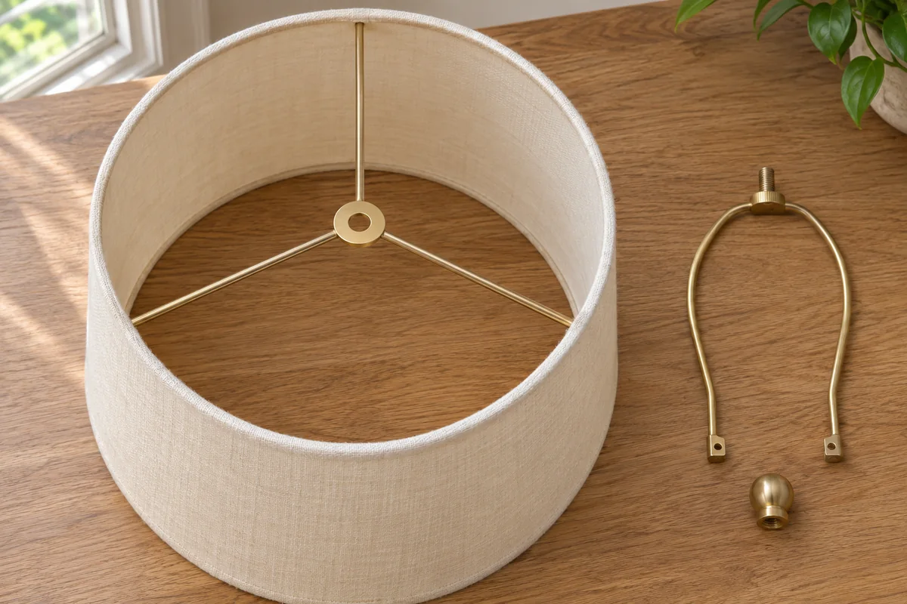

A shade can have the same width as the one you own and still sit too high or attach in a completely different way. Start with the lamp and shade you have. A few photos and measurements give you something concrete to compare with a seller's listing.

This guide covers an ordinary table lamp with a removable shade. The worked example keeps the existing harp, the curved metal support around the bulb.

## Identify the attachment first

Switch off and unplug the lamp, and let the bulb cool. Photograph the shade in place, then photograph the attachment as you remove the shade according to the lamp's instructions. On many table lamps, a threaded decorative cap called a finial holds a flat center washer at the top of the harp. This is a spider fitter. An uno fitter mounts at the socket, and a clip-on fitter grips a compatible bulb. The attachment determines which shades you can compare. [Lamps Plus fitter guide](https://www.lampsplus.com/ideas-and-advice/how-to-buy-a-lamp-shade-and-keep-it-clean/) and [Kirks Lane parts guide](https://kirkslane.com/lamp-parts-catalog-essential-lamp-shade-parts-and-lamp-making-supplies-for-spring-projects/)

For a spider shade, record the size of the center hole and send the seller a clear photo of the washer, harp stud, and finial if compatibility is unclear. Ask whether the shade works with the existing harp and whether the finial can secure it. If you have another fitting, use the corresponding dimensions and instructions for that model.

<figure class="article-inline-image">

<figcaption>The center fitting and the hardware underneath it are worth photographing before shopping. This generated illustration shows the parts separately.</figcaption>
</figure>

## Record width, height, and where the shade sits

Measure straight across the top and bottom rims. For a rectangular shade, write down width and depth at each end. Measure vertical height separately from the slanted side of a tapered shade. Compare measurements with the seller's diagram, since a listing may give the slant dimension. [Lamps Plus measuring guide](https://www.lampsplus.com/ideas-and-advice/how-to-buy-a-lamp-shade-and-keep-it-clean/)

On a spider shade, also note the fitter drop, the vertical distance from the top rim down to the point where the fitter rests on the harp. With the same harp, a deeper drop puts the top rim higher. To estimate the new bottom rim height, add the drop to the height of the harp's seating point above the table, then subtract the shade's vertical height. This helps you predict where the shade will sit relative to the switch and your line of sight.

Measure the space around the lamp at shade height. A shade can overhang a small table and meet a wall, shelf, or a cabinet door. Check the available space in the actual lamp position, including any movement nearby. A paper outline held in place with the lamp unplugged can help you visualize the footprint. Remove it before using the lamp.

## Compare two shades on the same lamp

Imagine a round shade on a harp with its seating point 17 inches above the table. The current shade is 9 inches tall with a ½-inch drop. Its bottom rim sits 8½ inches above the table. A 10-inch-tall candidate with a 2-inch drop would put the bottom at 9 inches, half an inch higher.

That candidate is also 16 inches wide at its lower rim, compared with the current shade's 14 inches. With both shades centered on the same harp, the new rim extends an extra inch on each side. The current rim is only ¾ inch from the wall, so the wider shade would hit it. The shopper can look for a narrower model or check a stable new lamp position with enough room to operate the switch.

| Check | What to write down | What to confirm before ordering |
|---|---|---|
| Attachment | Fitter type and close photo of hardware | Exact fit and required parts |
| Shade size | Top and bottom widths, vertical height | Same dimensions and measuring convention in listing |
| Position | Harp seating height and fitter drop | Where top and bottom rims will land |
| Surroundings | Space to wall, shelf, switch, and moving doors | Clearance in the intended position |
| Operating limits | Lamp markings, bulb type, and wattage | Manufacturer requirements for the full setup |

## Confirm the operating requirements

Use the lamp's specified bulb type and maximum wattage. CPSC guidance explains that exceeding the fixture rating can cause overheating. Check the lamp and shade instructions for clearance and any additional limits. The rim calculation above describes position only. If the lamp's label is unreadable or the bulb would contact the shade, resolve that with the manufacturer or a qualified repair professional before use. [CPSC electrical fire safety guidance](https://www.cpsc.gov/s3fs-public/SmokeAlarmWhyWhereandWhichCPSCPub559RevisedJuly2016PostReview.pdf)

Once the shade is secured as directed and the setup meets the instructions, check how it looks from the seat you actually use. Our [reading corner guide](/articles/test-reading-corner-existing-chair/) includes a way to compare page lighting and glare during ordinary use. If the table itself needs work, use the [side table repair comparison](/articles/repair-or-replace-side-table/) before planning a furniture purchase.
