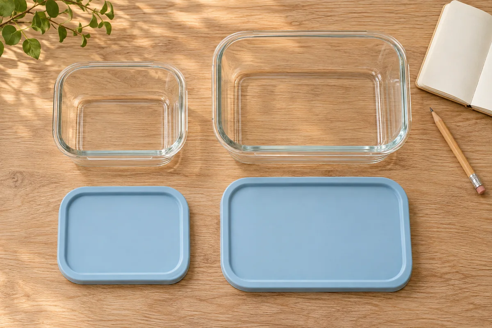

A drawer full of containers may still leave you without the pair you need. The useful count is not the number of bowls or lids: it is the number of **complete, identifiable sets that serve your routine**.

Before adding a lid rack, choose one drawer or shelf and match what you own. Keep the task small enough that you can put the kitchen back together afterward. This guide concerns organizing empty containers; it does not establish food-storage times, cooking suitability, or a leakproof seal.

## Bring back the pieces before declaring a lid missing

Start with clean, dry, empty containers and lids, prepared according to their own care instructions. Check the dish rack, dishwasher, lunch bags, and other usual return points for empty pieces. Leave containers holding food in their appropriate storage; simply note them as currently in use rather than moving food for a cabinet project.

Divide the cleared surface into three temporary groups: identified pairs, pieces awaiting identification, and items with a condition concern. Do not force a stubborn lid onto a container to complete the first group. Keep questionable pieces out of the ready-to-use collection while you check their instructions or contact the maker.

For one product-specific condition check, [Anchor Hocking's care guidance](https://www.anchorhocking.com/care-use/) says not to use its food-storage glass when chipped, cracked, or noticeably scratched. Use the guidance for the actual product you own; an organizing project is not a way to clear damaged equipment for use.

## Identify the pair instead of guessing from its outline

Look for the brand, product line, and model markings on both pieces. Photograph the markings so you do not have to hold a glass container upside down while searching. If the original packaging or instructions are available, use those to identify the intended lid.

[Glasslock USA's replacement-lid guidance](https://glasslockusa.com/about-glasslock/) illustrates the value of this step: it directs customers to the exact engraved model number and warns against choosing a lid by shape or estimated size alone. That is guidance for its replacement system, not a promise that every brand marks its parts the same way.

If the markings do not resolve the match, put the question in your inventory. A lid that rests on a rim is not proof of an intended pairing, a good seal, or suitability for carrying liquid. Avoid improvised heating, bending, or trimming to make pieces fit.

Keep care directions with the product record. A base and cover may have different instructions; do not transfer the base's appliance or cleaning permissions to its lid. Our [home product manual guide](/articles/organize-home-product-manuals/) offers a simple way to save the exact instructions without building another paper pile.

## Count the sets your ordinary week uses

For several ordinary days, note which complete sets leave the cabinet, which are in use, and which return from washing. Include the lunch containers that travel out of the home. Otherwise, you may mistake a busy weekday's empty shelf for a shortage of equipment.

Sort by job rather than keeping every piece at the front. Perhaps two identified sets serve weekday lunches, another holds a usual portion of leftovers, and a larger set is used only occasionally. Your household may need a different mix. Do not discard useful duplicates merely because an organizing photo shows fewer containers.

Record a genuine gap precisely: “The second lunch container has no identified lid.” That is more useful than “buy a new set.” Check the maker's current replacement options for that model before deciding between a replacement part, a different use allowed by its instructions, or retiring the incomplete item from this collection. Availability and compatibility still need confirmation; there is no assumed savings figure.

## Compare two arrangements using the same collection

Try the complete sets in the available storage before buying dividers. Use a single layer first to see the actual pieces and their retrieval needs. Keep heavy containers where you can handle them comfortably, and avoid precarious stacks.

**Pairs kept together:** Assign each base and its lid the same location. This may make a frequently used lunch set easy to collect, but it can occupy more space. Try it with the pieces you reach for most often rather than assuming every set needs the same treatment.

**Bases and lids separated:** Keep bases grouped by their identified family and lids beside them in an existing suitable compartment. This can make selection clearer when many shapes share a drawer, but only if the lid area stays easy to search. If nesting or stacking is allowed for your exact containers, check the maker's storage directions before using that approach; do not wedge unlike glass pieces together to save an inch.

For either arrangement, retrieve the set at the back and return it without dismantling the entire collection. Close the drawer slowly once to check clearance; stop if a lid catches rather than pressing it down with the drawer above. Follow our [small kitchen drawer guide](/articles/organize-small-kitchen-drawers/) for measuring the usable space and checking a proposed organizer's footprint.

<figure class="article-inline-image">

<figcaption>Record each intended pair before deciding where it belongs. This generated illustration does not establish a real product match or a tested seal.</figcaption>
</figure>

## Copy this pair-and-location worksheet

Use a short identifying description that everyone in the household understands. Put exact model details in the record rather than covering required product markings with an improvised label.

| Set or loose piece | Identification and condition | Actual job | Storage decision |
|---|---|---|---|
| Weekday lunch set A | Record base, intended lid, and care source | Leaves home on workdays | Pair together in the easy-reach zone |
| Leftover set B | Record verified match and any question | Used during ordinary meals | Compare paired storage with adjacent lid storage |
| Unmatched base C | Model photo; lid not yet identified | No ready-to-use assignment yet | Keep separate pending a maker check |
| Occasional large set D | Record complete pair and care source | Infrequent household task | Choose a reachable secondary location |

Add a follow-up date for unresolved pieces. That date is your reminder to identify or decide, not a deadline that makes an uncertain item suitable for use. Keep the unresolved group separate so it cannot quietly return to the daily pile.

## Example: seven bases do not mean seven ready sets

Imagine a household counting seven empty bases and eight lids. This is a hypothetical sorting example, not a tested collection or a recommended household quota.

Five intended pairs can be identified from the product records. Two bases and three lids remain unresolved. The household records those pieces separately instead of calling all seven bases usable lunch containers or ordering a complete replacement collection immediately.

Among the five identified sets, two serve weekday lunches, two serve ordinary leftover portions, and one is used occasionally. The household first tries keeping the four frequent sets with their lids in one drawer. The larger occasional set goes on another reachable shelf. If the main drawer becomes awkward to use, they compare a separate lid compartment using those same four sets.

The unresolved list now has a concrete task: check the two base models and ask about their intended lids. Some pieces may turn out to belong to each other; others may not. The count stays honest until that question is answered.

## Leave room for the return trip

Try the arrangement through normal washing and packing routines. Notice whether a returning lid has an obvious place and whether another household member can find a complete set without asking you.

If lids repeatedly land on the counter, change the return location or reduce the number of unrelated items sharing that zone. Do not buy a bigger organizer until you know which problem it would solve. A rack cannot identify a mystery lid for you.

Revisit the inventory when a piece is replaced, damaged, or no longer used. If you also need space for cleaning products, keep that a separate project with its own storage requirements; the [under-sink planning guide](/articles/under-sink-storage-around-pipes/) covers access and obstructions there. The food-container collection should remain a place to find intended pairs, not the new home for everything that no longer fits elsewhere.
