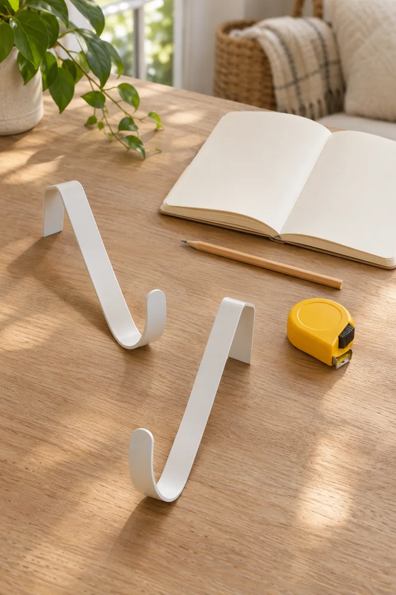

An over-the-door hook can give tomorrow's shirt a home without using floor space. But a bracket that slips over the top edge still has to pass a second test: the door must close, latch, and open normally with the storage in place.

Start with one ordinary interior bedroom or closet door and a short list of things you actually want to hang. This guide is a planning and fit-check routine. The generated photographs illustrate the idea; they do not document an installation we tested.

## Choose the door before the rack

Open and close the empty door first. Record any existing rubbing, sticking, or trouble latching. Report those problems before adding a hanger, so you don't confuse an existing issue with a new obstruction.

Check your rental rules before attaching anything. Read the exact model's assembly instructions, including whether screws or other fixings are required. For example, [IKEA's U.S. ENUDDEN page](https://www.ikea.com/us/en/p/enudden-hanger-for-door-white-60251665/) says it is mounted with screws. A product name or an over-door photograph alone doesn't establish a permitted no-drill installation.

If the door has a closer or fire label, opens into a shared hallway, or has an unfamiliar function, ask building management which accessories are permitted there before considering a rack. Keep this project to a suitable approved location. Use our [rental update permission template](/articles/ask-landlord-permission-rental-update/) when you need to describe the exact product and door.

## Separate door thickness from top clearance

With the door open and safely stationary, measure its thickness across the top edge where the bracket would sit. Work only where you can reach comfortably. Do not stand on furniture or put fingers in a closing gap.

Compare that measurement with the model's supported door thickness. Use the same units and the exact variant's instructions. [Umbra's Buddy double hook](https://www.umbra.com/products/buddy-over-the-door-2-hook), for example, lists doors up to 1½ inches thick. That specification belongs to that product; it isn't a standard for every hanger.

Next, check the space between the door's top edge and the frame at the intended bracket locations. A ruler may be too coarse to measure a narrow gap reliably. If you can't establish the clearance required by the manufacturer, record it as unresolved and ask the maker or building staff. A visible sliver of space doesn't prove the bracket will fit.

Look for trim, raised panels, or an uneven surface where the rack rests. Check whether the supplied protectors and fittings can sit as instructed. Don't bend the bracket, omit required parts, sand the door, or add homemade padding to make an incompatible model fit.

<figure class="article-inline-image">

<figcaption>Keep the model's fit requirements beside your door measurements. This generated still life illustrates preparation before installation.</figcaption>
</figure>

## Rehearse the way you'll use it

After permission and dimensional checks, install only as directed. Start with the rack empty. Gently move the door through its usual travel and close it normally. Stop if the bracket scrapes, the door needs extra force, or the latch no longer engages. Remove the accessory according to its instructions.

If the empty check passes, weigh each intended item with its usual contents. Follow both per-hook and whole-rack limits wherever specified. Umbra lists 5 pounds per hook for the Buddy double hook; don't transfer that rating to another model or treat it as permission to combine hooks for a heavier item. [Manufacturer specifications](https://www.umbra.com/products/buddy-over-the-door-2-hook)

Repeat normal movement with the intended, permitted load. Check where a hanging sleeve or bag goes when the door opens. Can it catch on the handle, strike nearby furniture, or stop the door opening as far as you need? Can everyone using the storage reach it comfortably? Fewer occupied hooks may serve the room better than filling every position.

## Keep a one-door fit worksheet

| Check | Record before committing | Decision |
|---|---|---|
| Door and permission | Room, existing operation, approved attachment method | Proceed, ask, or choose another spot |
| Door thickness | Your measurement and the exact model's supported range | Compatible or incompatible |
| Top clearance | Maker's requirement and what you can establish at each bracket | Clear or unresolved |
| Contact surfaces | Trim, finish condition, supplied protectors and fittings | Suitable or unresolved |
| Intended load | Each item, loaded weight, relevant product limits | Within limits or reduce the load |
| Normal use | Empty and loaded closing, latching, swing, and reach | Works normally or remove |

Here is a hypothetical decision: a bedroom door measures 1¾ inches thick, while the candidate hook allows a maximum of 1½ inches. The door exceeds that limit by ¼ inch. Reject that model before trying it, even if the top gap looks generous. A different model still needs every other check.

If the fit remains uncertain, give the shirt a place inside existing storage instead. Our [closet measurement guide](/articles/measure-closet-before-buying-organizers/) helps identify usable space. If you consider a wall hook, run the separate [surface and removal checks for adhesive hooks](/articles/removable-hooks-rental-wall-checklist/) first.
