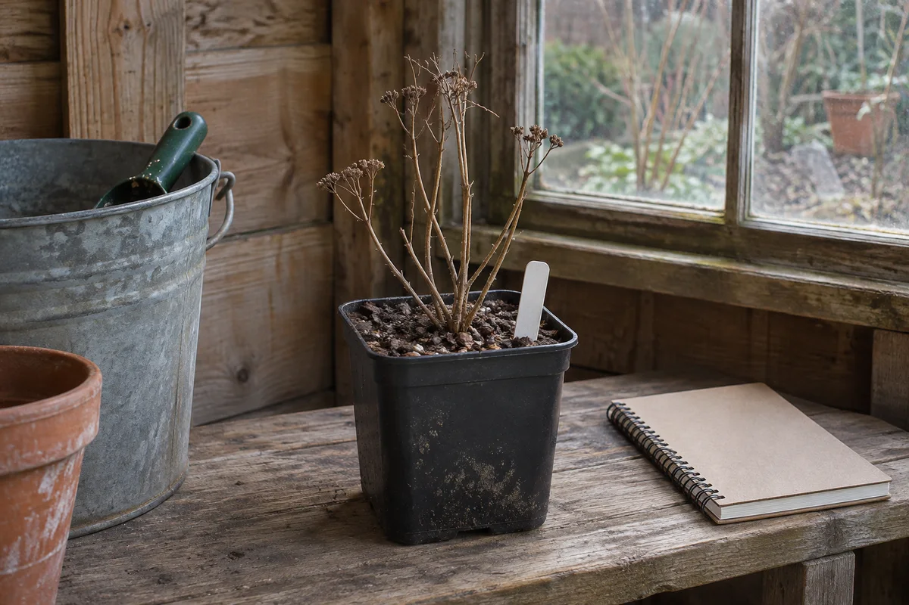

When a freeze is on the way, the biggest pot and the smallest pot on your patio may need different plans, even if both hold the same perennial. The spot that fits the pots in July may also be the one that catches winter wind or roof runoff.

Start with one decision per pot: **stay outside with a protection plan, move to a suitable shelter, or get a plant-specific answer first.** This guide focuses on hardy perennials in containers. Frost-tender plants, actively growing houseplants, and pots with unidentified plants need their own care decisions.

## Check the plant and the container separately

Write down the plant name from the tag or purchase record, including the variety if you know it. Compare its listed hardiness with your local conditions and look for guidance specific to growing it in a container. If you cannot identify the plant, leave its hardiness unresolved. A familiar-looking leaf is a poor basis for deciding where it spends the winter.

[Illinois Extension](https://extension.illinois.edu/news-releases/overwintering-potted-plants) explains that roots in containers are exposed to greater cold than roots in the ground. Its general outdoor screening rule is to choose plants rated for two zones colder than your location. Treat that as a starting point, not a survival prediction. A hardiness zone does not tell you how cold a particular pot will get against your wall or near an exposed patio edge.

Record the pot's size, material, condition, and drainage. [University of Nevada, Reno Extension](https://extension.unr.edu/publication.aspx?PubID=2103) singles out small or thin-walled pots for extra consideration and notes that repeated freezing and thawing can damage materials such as terracotta. Check the maker's outdoor winter guidance where available. A pot rated for winter weather does not establish that its plant can tolerate that location.

## Compare the patio corner with the shelter you actually have

Walk the patio and name a specific outdoor candidate. Is it out of the strongest wind? Does roof runoff land there? Can you reach each container for a check without moving the whole group? Keep drainage and the normal route through the patio clear. If this is a rental, use only locations and arrangements allowed by the property.

For hardy perennials, [Illinois Extension describes grouping containers in a protected spot and insulating around them](https://extension.illinois.edu/news-releases/overwintering-potted-plants). Ask your local Extension office which protection makes sense for your plants and site. Grouping is worth evaluating if you have an appropriate corner; it does not turn an exposed patio into a controlled winter environment. Our [small patio layout guide](/articles/small-patio-furniture-layout/) can help you map the remaining space once you mark the pots and access route.

For a garage or shed, check the place where the pots would actually sit. Record temperature swings through a cold spell if you can, rather than relying on one afternoon reading. Keep the location accessible for care. [UNH Extension](https://extension.unh.edu/blog/2018/11/how-can-i-overwinter-perennials-still-containers) describes a cool unheated space around 30–40°F as one option for dormant perennials. That range is an example from its guidance, not a target for every plant. Verify the plant's needs and the actual shelter conditions before assigning it there. If you have no suitable spot, ask about local alternatives rather than defaulting to a warm, dark closet.

<figure class="article-inline-image">

<figcaption>Check conditions where the pot would sit. This generated scene illustrates a candidate location, not a tested winter setup.</figcaption>
</figure>

## Put the winter checks on the same plan

Write down how you will reach the pot and check the growing mix. A roof that keeps rain out also means that you cannot count on rain to water the container. Conversely, a container left outside may get more water than you expect. Check rather than watering every pot on the same day.

UNH Extension includes periodic watering for sheltered dormant plants when conditions are warm enough, and Nevada Extension advises avoiding complete drying. Follow the guidance for the plant and location, check when the mix is thawed, and keep drainage working. A reminder to look at the pot is more useful than a fixed watering volume for every container. If the location repeatedly stays frozen, too wet, or too warm for the plant's needs, revisit the location with local advice.

Make a spring note too. Record what you need to confirm before returning the pot to a more exposed spot. For a container you intend to reposition, our [patio sunlight log](/articles/record-patio-sunlight-before-buying-plants/) can help you record the new location once the season changes.

## Copy this winter pot worksheet

| Pot and plant identity | Outdoor exposure and pot condition | Candidate winter location | Next check or unresolved question |
|---|---|---|---|
| Large container, identified hardy perennial | Sheltered wall; check runoff and drainage | Protected patio corner | Confirm local container protection |
| Small thin-walled container, identified hardy perennial | Exposed edge; little room to group it | Cool shed, pending measurement | Record temperature near the pot through a cold spell |
| Container with missing tag | Hardiness unknown | No location approved yet | Identify the plant and get care advice before a freeze |

Keep the record with your plant tags. If a container is too heavy to move safely, leave that option open until you have appropriate help or a workable local alternative. The worksheet should reveal a problem early enough to act on it.

## Example: one patio, three different decisions

Imagine a renter with the three pots in the worksheet. The large one can fit beside a sheltered wall with drainage and the route to the door still clear. The renter checks whether local advice supports leaving that particular perennial outside in that container, then plans a protected grouping only if there is room.

The small pot holds the same identified perennial. Its previous place catches wind, and the available patio corner cannot take another pot without crowding the route. The shed is a candidate, so the renter checks temperatures at the proposed spot instead of assuming that every unheated structure behaves the same way. The untagged third plant stays on the question list, with identification ahead of any decision about dormant storage.

The example is a planning exercise; none of the plants has a predicted spring outcome. If furniture and cushions also need to move, use the separate [small patio winter storage guide](/articles/small-patio-winter-storage-plan/) to make sure those pieces do not displace the plant checks or block the patio.
