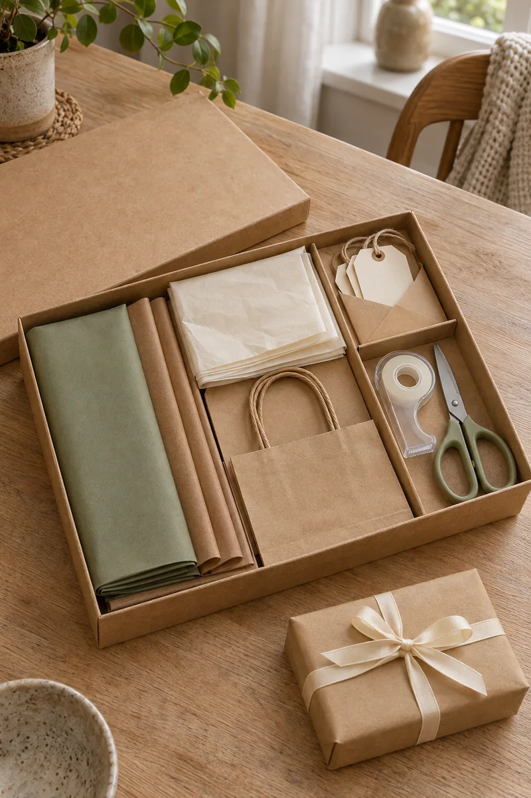

Wrapping gifts on the dining table is manageable until the scissors disappear under paper and the supplies stay out through dinner. Build a kit around one wrapping session, with a place for the finished gifts and a clear route back to storage.

Start with a box or container you already have. Its job is to carry your working supplies to the table and hold them when you finish. A small kit works best when you choose its contents from the gifts you actually need to wrap.

## Match the supplies to this round of gifts

Gather the presents, boxes, reusable bags, paper, tags, and tools in one place. Check each gift against its intended packaging before counting it as ready. A bag is useful only if that particular gift fits, and a saved sheet needs enough intact paper for the box you want to cover.

Hallmark's wrapping guide begins with gathering supplies, then uses the actual box to check paper coverage before cutting. Use that same check when assessing a leftover sheet. Bring the paper around the box and check the end folds before committing to it. For the wrapping steps themselves, follow the [Hallmark box-wrapping guide](https://ideas.hallmark.com/articles/gift-wrapping-ideas/how-to-wrap-a-present/).

Keep three small groups as you sort. Put usable supplies for this session into the kit. Set aside usable extras that have another storage place. Handle damaged or unwanted material according to its reuse or disposal options. This keeps an unrelated pile of ribbon from hiding the tape you need now.

## Give the tabletop three jobs

Clear a clean, dry surface large enough to handle your paper and turn the gift comfortably. Protect the finish when needed, and keep cutting tools under your control and out of children's reach.

Set the supply box on one side. Leave the middle open for the gift and its paper. Reserve the other side, or a nearby suitable surface, for completed gifts. Keep a separate place for offcuts so they do not slide back beneath the box you are wrapping.

Try the arrangement with the largest gift in this session before spreading out the rest. Can you reach the tape without laying the gift on top of the tags? Can you move a finished package away while keeping the working area clear? If the table is too small, wrap one item at a time and bring only its packaging to the surface.

<figure class="article-inline-image">

<figcaption>A compact kit needs a place for both the paper and the small tools. This generated scene illustrates one possible arrangement.</figcaption>
</figure>

## Try a five-gift inventory

Imagine you have five gifts ready to package. Three are already in boxes, and two fit reusable gift bags. You have two intact sheets that cover two of the boxes, plus one paper roll that can cover the third. Both bags are usable, but you have tissue for only one of them.

In this hypothetical session, the gap is tissue for one bag if you want to use it. Another roll and more bags would add storage without resolving that gap. You might choose a different presentation for that gift or obtain only what you decide is necessary.

| Gift or supply | Check before starting | Return plan |
|---|---|---|
| Three boxed gifts | Two saved sheets fit; use the roll for the third | Return the roll to its existing separate spot |
| Two gift bags | Each gift fits its assigned bag | Keep unused bags flat if their construction allows |
| Tissue | Enough for one planned bag | Decide what the second gift needs |
| Tags and pen | Five tags and a working pen | Use a small envelope or compartment |
| Scissors and tape | Available and usable | Return to their assigned tool compartment |

This is a planning example, not a required kit size. Write your own counts before buying anything. If small supplies are scattered through a drawer, use the sorting approach in our [small-drawer organization guide](/articles/organize-small-kitchen-drawers/) to give them an accessible home.

## Check that the kit really packs away

Choose how to store paper before loading the container. Folded sheets can work if you accept the creases. If you want to keep paper rolled, retain a suitable separate location and treat the box as the tool kit. Avoid forcing long rolls into a container that cannot support or contain them.

Put small tools in a compartment where they are easy to retrieve. Keep usable offcuts together in a flat envelope or folder, and check them first next time. Return only pieces you expect to use. EPA encourages reuse of gift bags, boxes, and tissue paper. Shiny or laminated wrapping paper often cannot be recycled, so check your local program before placing discarded wrap in the bin. [EPA gift-wrap and paper guidance](https://www.epa.gov/recycle/how-do-i-recycle-common-recyclables)

After the first session, close the kit and return it to its intended spot. Check that the lid closes freely, the container is manageable to carry, and the scissors are stored safely. If a shelf is the destination, our [closet measurement guide](/articles/measure-closet-before-buying-organizers/) explains how to check the opening and retrieval space.

Finish by clearing the table for its next use. A kit that is easy to take out and return is more useful in a small home than a large supply collection that has no convenient place to go.

For a small boxed gift, [try a fabric square you already own](/articles/wrap-boxed-gift-fabric-square/). Check the folds and knot with the actual box, then decide whether the cloth goes with the gift or returns to your kit.
