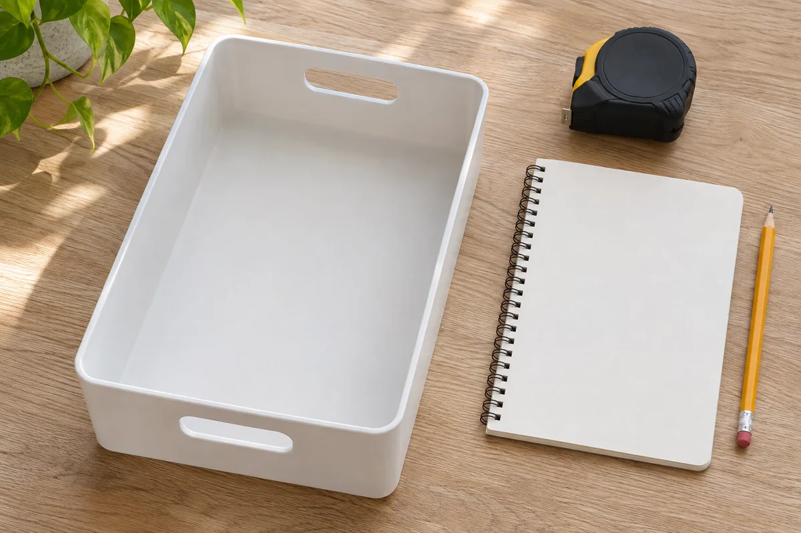

A bin can make a row of bottles easier to lift, but it cannot tell you whether the products belong together or whether the cabinet is a suitable place for them. Start with the labels and access requirements, then choose the storage arrangement.

For one small area, make a record linking **the exact product, its storage directions, and a named location**. Keep questions visible before buying an organizer. This is a household planning guide, not a chemical compatibility chart, spill-cleanup procedure, or certification that a cabinet is safe.

## Check the current location without creating a sorting pile

Read accessible labels where the products are already stored. Work through one area at a time; do not empty chemicals onto the kitchen table or leave them unattended while you shop for bins. Keep children and pets away during the work, and maintain the required secure storage throughout.

If a container is leaking, corroding, damaged, or unidentified, stop the organizing task for that item. Do not open it to smell or identify the contents. [EPA's household hazardous waste guidance](https://www.epa.gov/hw/household-hazardous-waste-hhw) directs people with corroding containers to local hazardous-materials officials or the fire department for handling instructions. Ask for appropriate local guidance rather than inventing a repackaging or cleanup method.

The [CPSC's poison-prevention advice](https://www.cpsc.gov/Safety-Education/Safety-Education-Centers/Poison-Prevention-Information-Center) calls for chemicals and cleaning supplies to be in a locked cabinet or box and out of children's reach, in their original child-resistant containers. Plan for visiting children as well as those who live with you. A decorative tray or open cart does not meet that access requirement.

## Record directions before grouping by room

For each product, note its name and the storage section of its label. Record restrictions on location, temperature, ventilation, and nearby materials when the label gives them. Leave an unclear instruction as a question for the manufacturer, not a blank you fill with a guess.

A category such as “bathroom cleaners” describes where products are used. It does not establish that every product in the category can share a bin. Do not use matching bottle colors or container shapes as a substitute for the storage directions. Confirm any separation requirements before assigning a shelf or tray.

EPA says to follow product storage directions, retain original containers and labels, and never use food containers for hazardous products. Keep those labels readable when choosing how bottles face on the shelf. A digital photo can make a record easier to consult, but it does not replace the label on the container.

Avoid decanting products into matching decorative bottles to simplify the layout. Do not combine hazardous leftovers or top one product up with another. Less liquid in two bottles is not a reason to create one new mixture.

## Assess the cabinet before the organizer

Name the proposed location precisely: for example, “utility cabinet, middle shelf,” rather than “somewhere high.” Check whether that location can meet each product's conditions and the access precautions. A lock addresses access; it does not resolve incompatible products or unsuitable temperature and ventilation.

Measure only when you can do so without disturbing questionable containers. Include the actual original package, its cap or trigger, the shelf opening, and the room needed to take it out without tipping other products. Check shelf and organizer load limits from their makers. Do not lay a bottle on its side just because the shelf is too short.

If the candidate is below a sink, inspect the cabinet condition and maintenance access separately. Our [under-sink storage guide](/articles/under-sink-storage-around-pipes/) explains how to map pipes and keep valves accessible. That fit check does not establish chemical-storage suitability; a different location may be needed.

<figure class="article-inline-image">

<figcaption>Choose an organizer after resolving the storage requirements. This generated illustration shows an empty tray, not a verified chemical-storage combination.</figcaption>
</figure>

## Copy this label-to-location worksheet

The entries below describe the record to make; they do not assign actual products to a shared shelf.

| Entry | Record this | Pause when |
|---|---|---|
| Exact product | Name and readable original label | Contents or identity are uncertain |
| Storage directions | Conditions and separation requirements from the label | An instruction is missing or unclear |
| Access protection | Named locked location, child reach, household use | The plan relies on an open bin or height alone |
| Package fit | Original container upright, opening and retrieval space | The cap catches or another bottle must be tipped |
| Return step | Who puts it back and secures the storage | Supplies remain out after the task |
| Unwanted product | Label directions and local disposal contact | Disposal or handling has not been confirmed |

You can keep this short record with your [home product instruction folder](/articles/organize-home-product-manuals/). Use separate entries for products whose requirements differ. Do not let a tidy spreadsheet conceal an unresolved storage question.

## Example: a caddy purchase stays on hold

Imagine someone considering a single handled caddy for everything used to clean the bathroom. This is a hypothetical planning example, not a tested product grouping.

They first record the original packages and the instructions. One label has a storage restriction they do not yet understand, and the proposed caddy would remain on an open shelf. They pause the purchase. The next jobs are to clarify the product requirement and confirm an appropriate locked location, not to find a bigger caddy.

After those questions are resolved, an organizer might help retrieve only a compatible subset. It might also turn out that no extra container is needed. The decision follows the requirements and the retrieval task; there is no assumed universal “cleaning kit.”

## Plan the return, not just the starting arrangement

Check how the supplies return after use. The adult using them should be able to put each original package back in its assigned location and secure the cabinet or box. Follow package closure instructions, and do not leave supplies in an accessible temporary spot while attending to another task. CPSC specifically says laundry packets belong in their original containers, out of children's sight and reach, and should not be handled by children.

For unwanted hazardous products, EPA recommends label disposal directions and local environmental, health, or solid-waste guidance. Do not pour them down a drain simply to free shelf space. Obtain instructions before transporting or changing the storage of questionable containers.

Once the product arrangement is resolved, keep unrelated kitchen and food storage elsewhere. Our [kitchen drawer guide](/articles/organize-small-kitchen-drawers/) offers a separate project for utensils and everyday tools. The useful result here is a clear location record, readable labels, and a return routine that preserves the storage precautions.
