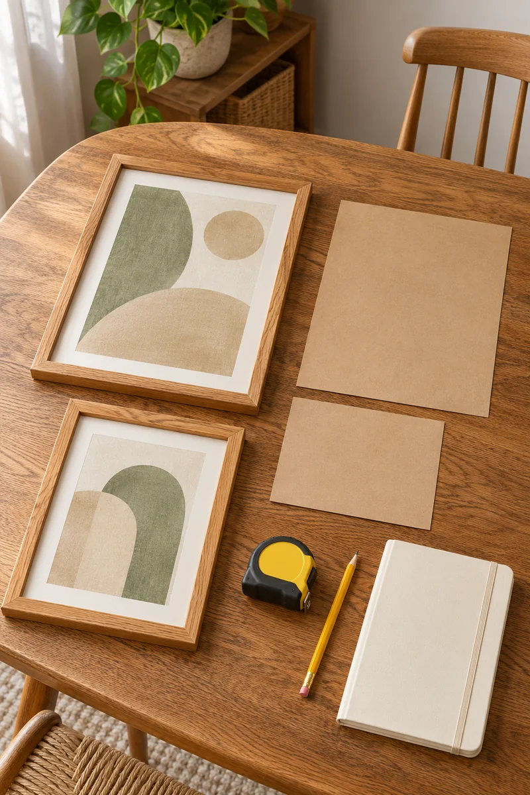

A group of pictures can look balanced on the floor and feel too wide once it is above your sideboard. Make a paper copy of each frame before deciding where the pictures belong. You can compare two arrangements using the frames you already own and save a layout worth installing.

IKEA recommends paper templates to plan a structured picture wall. The steps below turn that idea into a small project with a written layout record. Start with two or three frames so you can compare the whole group at once. [IKEA picture wall guide](https://www.ikea.com/us/en/product-guides/picture-wall-ideas-to-refresh-any-room-pxm5cfc1b1fa38011eca0f0b9d3c4aa5e1f/)

## Copy the outside of each frame

Gather plain paper, a pencil, a ruler or tape measure, and the frames. Join smaller sheets on the back if you need a larger rectangle. Protect both the table and the frame while working. For delicate or difficult-to-handle pieces, measure the outside dimensions and draw the rectangle instead of laying the frame down.

Use the frame's full outside width and height. The photo or print size on a package may describe the opening, so measure the actual object you plan to hang. Mark each template on the front with a simple identifier, such as A or B, and the intended top edge. Keep a matching note identifying the picture.

Place the templates on a table or clear floor first. Try equal gaps between the outside edges. With mixed frame sizes, choose one alignment to compare, such as a shared top edge or a shared centerline. Photograph each arrangement from above and keep the option that suits the pictures you have.

<figure class="article-inline-image">

<figcaption>Use the outside frame dimensions for each paper rectangle. This generated scene illustrates the planning supplies.</figcaption>
</figure>

## Preview the group in its actual location

If temporary tape is allowed and compatible with the wall finish, follow its maker's instructions for application and removal. Check any rental restrictions first. If you cannot establish compatibility, keep the arrangement on the floor and use a measured sketch or a photo mockup to compare positions. Our [rental permission guide](/articles/ask-landlord-permission-rental-update/) helps you describe the proposed change.

For a wall preview, use the light paper templates and a suitable temporary attachment method. Leave switches, outlets, vents, and access panels available. Compare the arrangement with the room in ordinary use, including open cabinet doors and any lamp that normally sits on the furniture below.

Look from the seat where you spend time, then from the doorway. Try one position, take a photo, and move the entire group slightly for a second comparison. Choose a height that works for the pictures, furnishings, and viewing positions in your room. Record the bottom-edge height from a fixed reference, such as the floor, so you can find the preferred position again.

## Work through a two-frame example

Suppose two frames each measure **12 inches wide by 16 inches tall on the outside**. A **3-inch gap** creates a group that is **27 inches wide**. Centered above a **36-inch-wide sideboard**, that leaves **4½ inches on each side** when viewed straight on.

Those are hypothetical planning dimensions. The gap and side margins are starting choices for this example. If a lamp overlaps the right frame in your wall preview, compare moving the whole group, moving the lamp to another suitable spot, or displaying just one picture. Save a photo of the choice that works with the furniture in use.

| Record | Layout A | Layout B |
|---|---|---|
| Frames and orientation | A and B, both vertical | |
| Outside group width | 27 inches in the example | |
| Edge-to-edge gap | 3 inches in the example | |
| Bottom-edge height from floor | Measure your chosen position | |
| View from seat and doorway | Note overlap or awkward placement | |
| Preferred option and reason | Write after comparing both | |

## Keep the layout with the hanging plan

Once you choose an arrangement, photograph it straight on and record the dimensions. Label the saved image with the frame identifiers. The template's outline locates the frame's edges. Find the actual attachment position from the frame hardware and the selected hanging system's instructions.

Before mounting, confirm permission, wall construction, frame weight, and the exact product's limits. Command's picture-strip guidance includes restrictions on wallpaper, locations over beds, and valuable or irreplaceable items. Check the full instructions for the product you intend to use, including surface preparation, waiting times, and removal access. Our [removable-hook checklist](/articles/removable-hooks-rental-wall-checklist/) explains the questions to resolve before choosing an adhesive product. [Command picture-hanging instructions](https://www.command.com/3M/en_US/command/how-to-use/picture-hanging-strips/)

Keep your chosen layout even if the mounting method still needs resolving. You can finish the visual decision and return to installation once the requirements are clear. For more ways to work with the room you have, see our [living room refresh guide](/articles/reversible-living-room-updates/).
