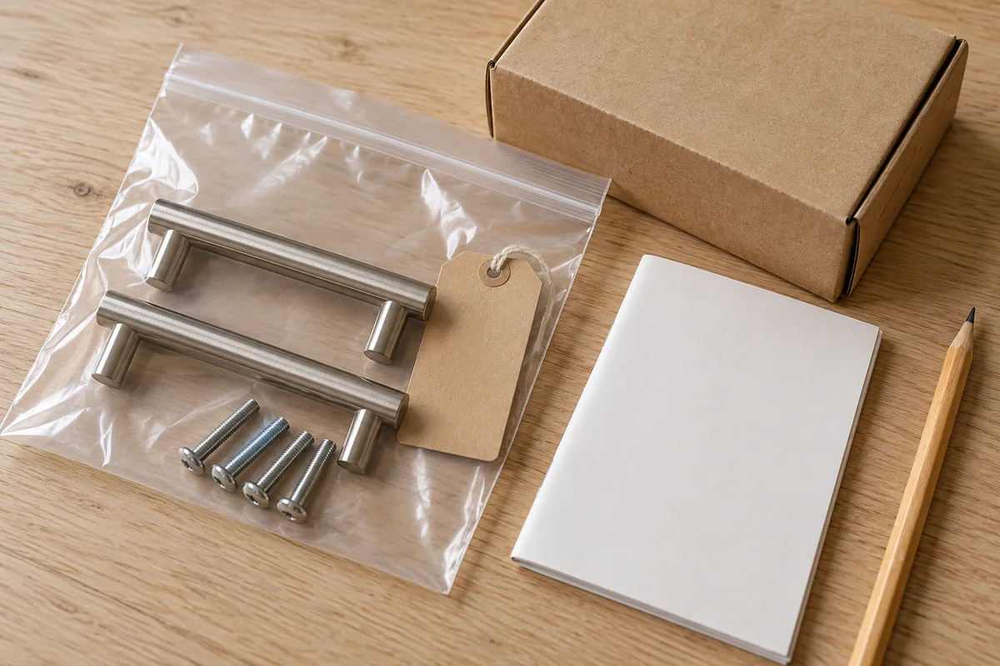

A small rental update can be easy to install and awkward to undo. The original cabinet pulls disappear into a moving box. A picture's release tabs end up behind furniture. The instructions saved on a shopping page no longer match the product in the room.

Before buying, answer three questions: **What comes off, what goes back, and where is everything needed for that job?** Put the answers on one project card. This guide is a planning method for optional decorating, not a repair manual, permission to alter a rental, or a promise about damage or a security deposit.

## Define the finish you are expected to return to

Start with one small change, such as replacing two permitted cabinet pulls using the existing holes. Write its location precisely: “Kitchen, two doors below the sink.” Avoid “the small handles,” which may describe several different sets by the time you move.

Check the current agreement and any written approval for the expected end state. Are the originals to be reinstalled, or has management approved leaving the replacement? If that answer is unclear, ask before proceeding. Our [rental update request guide](/articles/ask-landlord-permission-rental-update/) helps you describe the scope and ask about restoration without assuming that all rentals have the same rules.

Record the answer you actually receive. Do not turn “you may change these pulls” into an assumed agreement about holes, paint, or what can remain afterward. If the scope changes later, keep the new reply with the original project record.

## Read the removal page while the product is still a candidate

Find the directions for the exact model, including the removal section, before deciding to install it. Save the product identity and a readable copy of the supplied instructions. A retailer's order confirmation identifies a purchase; it does not necessarily include the procedure you will need later.

Check what the removal sequence requires you to reach. Can you access the fasteners or release tabs after the room is furnished? Would a nearby cabinet, shelf, or fixed obstruction prevent the prescribed movement? Do not start removing an installed item simply to rehearse these questions; assess the directions and proposed location first.

For one concrete example, [Command's U.S. picture hanging strip directions](https://www.command.com/3M/en_US/command/how-to-use/picture-hanging-strips/) show a frame-removal step followed by slowly stretching the strips downward along the wall at least 15 inches, without pulling them outward. That makes access below the strips a planning issue. It is guidance for that product family, not a removal method for wallpaper, film, every hook, or every adhesive.

If you cannot preserve the required access, change the location or choose a different approach before attaching anything. For surface, load, and installation checks, use our [removable hook wall checklist](/articles/removable-hooks-rental-wall-checklist/). Knowing a removal method does not establish that the surface is suitable for installation.

## Give the original parts a location, not just a bag

For an approved hardware swap, prepare the storage before taking anything off. Assign a project name, photograph the originals in place, and decide how you will keep each location's parts together. Our [pre-project room record](/articles/document-rental-room-before-decorating/) explains how to connect wide photos and details so you can identify the same area later.

Keep original pulls with their original fasteners, separated from the replacements and their fasteners. Label the container with the room, cabinet group, quantity, and project-record location. If two sets differ, give them separate bags rather than assuming you will recognize them from their finish.

Store the kit in a place you can name now: “hall closet, upper shelf, rental-parts box.” Put that same location on the digital project card. A note saying “kept somewhere safe” is not a retrieval plan. Keep small parts out of children's and pets' reach, and choose storage that suits the parts and their packaging instructions.

Do not discard an unfamiliar original part because a replacement does not use it. Identify it before proceeding. For mounting dimensions, fastener compatibility, and the limits of an existing-hole swap, see our [cabinet pull fit guide](/articles/measure-cabinet-pulls-before-replacing/). This removal plan does not supply installation instructions or authorize new drilling.

<figure class="article-inline-image">

<figcaption>Group retained parts by their original location and record where the kit lives. This generated illustration is not a tested hardware set or a completed rental project.</figcaption>
</figure>

## Separate reusable parts from supplies needed again

A component that can be used again may still need new consumables. Record those separately so a future removal or relocation does not begin with an incorrect assumption about reuse.

[Command's U.S. FAQs](https://www.command.com/3M/en_US/command/contact-us/faqs/) distinguish many reusable hooks, which need the correct replacement strips, from the strips themselves, which are single-use. The same guidance makes the strip type and size product-dependent. Save the exact identity rather than treating any leftover adhesive strip as a compatible refill.

For another kind of update, use that maker's own rules. Do not extend the hook example into a claim that a removed sheet of adhesive film, wallpaper, or another attachment can be reused. Put any unanswered question in a **resolve before installation** column.

The project kit is not an invitation to collect solvents, repair products, or speculative supplies. Save the directions and parts first. Buy only what the verified procedure actually requires, following its storage and safety instructions.

## Copy this removal-plan card

Keep one card per change. Complete the planning entries before installation; leave actual completion dates blank until the work happens.

| Entry | Write this down | A reason to pause |
|---|---|---|
| Scope and end state | Exact location, allowed change, agreed restoration | Permission or expected finish is unclear |
| Product identity | Model, supplied directions, removal-page location | Instructions do not match the candidate |
| Removal access | Parts to reach and movement the directions require | Furniture or a fixed obstacle blocks access |
| Original-parts kit | Parts, quantities, location labels, storage shelf | Originals cannot be identified or stored |
| Later supplies | Reusable pieces versus specified fresh consumables | Compatibility or reuse is assumed |
| Timing and help | When to review, who to ask, unresolved questions | The plan depends on an unconfirmed repair |
| Completion record | Actual removal date, photos, follow-up message | Fill in only after removal and review |

Save the card beside the before photos, approval, and instructions. Open the saved files once to confirm they are readable. Our [home product manual guide](/articles/organize-home-product-manuals/) offers a folder method you can use without buying another app.

## Example: two pulls now, two originals for later

Imagine a renter considering two black pulls for the kitchen doors below the sink. This is a hypothetical organizing example, not a tested swap or a recommendation for a particular product.

In this example, management permits a compatible existing-hole replacement and asks for the original nickel pulls to be returned at the end of the tenancy. The renter records that reply and completes the separate fit checks before starting. They do not treat the permission as approval to enlarge holes or alter the finish.

They prepare one bag for the two original pulls and their four original screws. The bag is labeled with the two-door location and goes in a small box on the hall closet's upper shelf. Replacement fasteners remain separate. The project card points to that shelf and the original-location photos.

Before going ahead, they consider whether the agreed restoration depends on more than reinstalling parts. If the replacement would reveal a finish mark or require an unapproved repair, the plan stays unresolved. Keeping the old pulls is useful, but it does not guarantee that every visible effect of the change can be reversed.

The decision is small enough to review: one permitted location, one retained-parts kit, and a known question-and-help route. There is no assumed repair budget, promised removal time, or guaranteed deposit outcome.

## Review the plan before packing the room

Reopen the card when the project changes, when its storage location changes, and before you start packing for a move. Check that the original parts are still present, the directions still match, and any required help or management discussion can happen before your intended removal day. Do not invent a universal number of days for every product and rental.

When removal actually happens, follow the supplied procedure and current manufacturer guidance. If a tab breaks, a fastener resists, or the finish begins lifting, stop and seek product-specific help rather than improvising a repair. Command's FAQ, for example, warns against yanking off a hook after a broken tab; that is not a reason to apply an unrelated adhesive-removal trick to your wall.

Leave electrical work, plumbing, required furniture anchors, safety devices, and structural changes outside this optional-decorating plan. Do not remove required safety installations to make a project appear reversible. Ask management and the appropriate qualified professional about work outside your scope.

After removal, add matching location photos and the actual date to the record. Keep any remaining issue visible in the notes and use the appropriate follow-up process. The useful result is a change you can explain and prepare to undo, with its original parts and instructions still findable.
