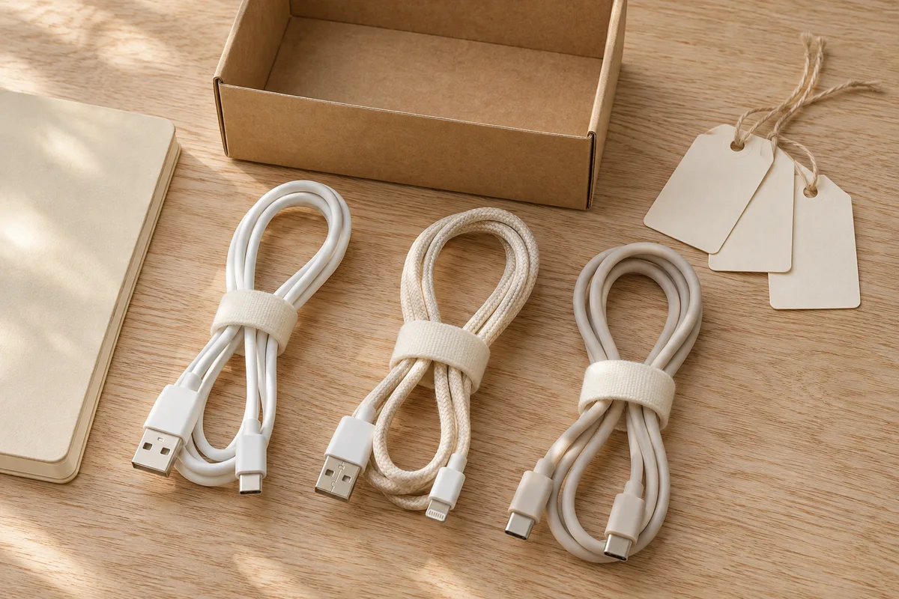

A charging spot needs to work when you come home with groceries, when someone else uses the desk, and when you pick up your phone again. A beautiful box of tangled powered adapters does not solve those everyday handoffs.

Start with **one device, one usable surface, and one cable route**. Decide where that combination belongs before buying a multi-device stand or attaching cable clips. This guide organizes a small domestic charging area; it does not assess an outlet, design an electrical installation, or establish charger compatibility.

## List what actually needs to charge here

For a few ordinary days, note where you put each device down and where you next need it. Do you want your phone near the desk during the day, or ready to collect by the door? Does a tablet belong to a shared evening routine? A laptop that travels to work may not need a permanent place beside the entryway.

Write down each device separately. “USB stuff” is too vague to help you return a cable to its owner. Record the exact device and the charging equipment its maker specifies. The shape of a connector alone is not your compatibility check; consult the device's instructions for the required equipment.

Split the list into daily charging, occasional charging, and disconnected spares. This is a household inventory, not a reason to replace working equipment. If a cable's purpose is unknown, set it aside for identification rather than plugging it into whatever happens to fit. Our [home product manual folder guide](/articles/organize-home-product-manuals/) helps connect a device model with its own instructions.

## Choose the surface and outlet together

Consider places with an existing reachable outlet and a stable, dry surface that can remain clear. Look at the device, cable, adapter, outlet, and surrounding furniture as one arrangement. A tabletop with plenty of room is a poor candidate if its usable cable route crosses the doorway.

For an iPhone example, [Apple's safety guidance](https://support.apple.com/guide/iphone/important-safety-information-iph301fc905/26/ios/26) calls for ventilation around the phone and charging equipment, warns about moisture and damaged accessories, and directs users of its USB power adapter to plug it directly into an outlet. It also warns against covering connected equipment with bedding. Follow the directions for your exact equipment; the example does not specify charging requirements for every device.

Plan an open arrangement you can inspect and reach. Do not make an ordinary closed drawer, decorative cable box, pillow, or basket into the home for operating chargers. Keep storage for disconnected accessories separate from the working charging location. If a proposed setup depends on added outlets, wiring changes, or assessing questionable electrical equipment, leave it unresolved and consult the appropriate qualified professional.

Do not move furniture in front of an outlet and then count the hidden space as organized. You still need access to connect, disconnect, and check the equipment as its instructions require.

## Walk through the ordinary movements

Before powering anything, place the device on the candidate surface and lay out its disconnected cable. Check the route with the chair pulled out, the drawer open, and the nearby door moving normally. Avoid positioning a cable where furniture would pinch it, where it would hang through a walking route, or where reaching for the device would drag another item off the surface.

This is a layout rehearsal, not an electrical safety test. Do not close a door on a cord to see whether it survives. Reject a route that relies on squeezing it through a moving gap.

Leave enough usable surface for the way the area already works. A shared desk may need a clear writing area; an entry console may need somewhere for a bag. If charging takes over that whole task, choose a second location or reduce the number of devices assigned there. Our [small entryway landing-zone guide](/articles/small-entryway-without-a-closet/) can help keep arrival storage from taking over the route through the room.

## Give disconnected spares a different home

Once you identify the daily equipment, put verified spare cables in a small, named storage location. Label their purpose in your inventory and use a loose storage arrangement consistent with their instructions. Keep labels from covering required product markings, connectors, or ventilation areas.

[Apple's adapter and cable guidance](https://support.apple.com/en-gb/102193) recommends holding the connector when unplugging rather than pulling the cable, and stopping use of damaged accessories. A frayed cable does not become a useful backup because it is neatly tied. Do not repair it with an organizing accessory.

Use the amount of spare equipment you actually retain to choose a container, rather than filling a new organizer with unidentified cables. Keep stored accessories and small ties out of children's and pets' reach. For a drawer that already holds many unrelated objects, use our [kitchen drawer sorting method](/articles/organize-small-kitchen-drawers/) for the task-zone idea, while keeping electronics away from wet or food-preparation areas.

<figure class="article-inline-image">

<figcaption>Identify disconnected spares before assigning their storage. This generated illustration does not verify the pictured cables' specifications or compatibility.</figcaption>
</figure>

## Copy this charging-spot worksheet

Complete one row per device, even when two devices might share a location. Leave an unanswered compatibility or outlet question visible instead of treating it as solved.

| Device and routine | Verified equipment and instructions | Candidate surface | Disconnected route check | Decision or next step |
|---|---|---|---|---|
| Daily phone; collected after breakfast | Exact model, adapter, and cable record | Desk or console | Chair, door, reach, and remaining surface | Keep, move, or resolve a question |
| Shared tablet; used in the evening | Its own equipment record | Second candidate | Check while the room is in ordinary use | Decide whether simultaneous use is needed |
| Occasional accessory | Identify before assigning a charger | May need no permanent station | Review when used | Store disconnected equipment separately |

Add the spare-storage location beneath the table. Anyone who uses the system should be able to find the intended cable without guessing. If equipment is shared, agree who puts it back and when; do not silently relocate someone else's daily charger.

## Example: a console loses to the existing desk

Imagine a household comparing two places for one phone. This is a hypothetical planning example, not a tested installation or product recommendation.

The entry console looks convenient, but the existing cable cannot follow an unobstructed route from its outlet to the proposed phone position. Opening the cabinet door would interfere with that route. The household rejects that arrangement rather than hiding the problem behind a decorative box.

At the desk, the phone can rest on a clear part of the surface near a reachable existing outlet. With everything disconnected, they check the chair's movement and confirm that the cable need not cross the floor route. They still check the equipment instructions before using the location; the rehearsal alone does not establish electrical suitability.

They assign only the phone to the desk. A tablet stays with its own routine elsewhere, and identified disconnected spares go in the hall closet. No new stand or charging hub is needed for this initial arrangement. If the desk later becomes too crowded, they reopen the decision instead of stacking more devices onto the same surface.

## Recheck before adding accessories

After using an instruction-compliant setup during ordinary routines, note what keeps moving. Is the cable disappearing into a work bag? Does the device take the place someone needs for writing? Solve the repeated handoff first.

Buy a clip, stand, or organizer only for a named remaining problem, and review its own attachment and use instructions. Do not use an accessory to force a cable route that failed the layout check. If the device, adapter, furniture, or household routine changes, revisit the worksheet. A useful charging spot remains reachable and understandable after the first tidy photograph.
