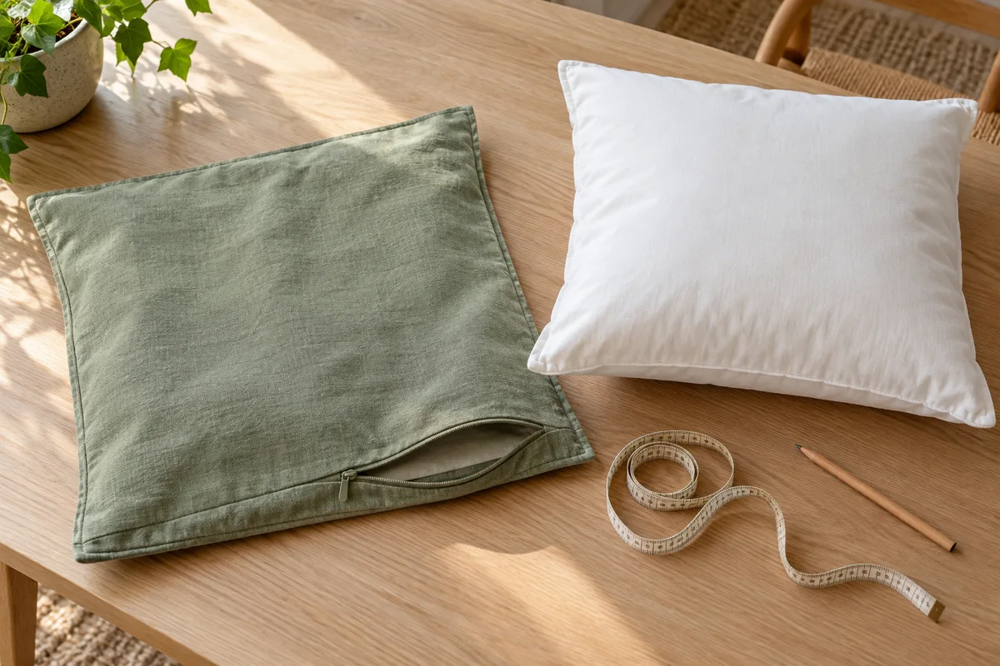

A different pillow cover can change a sofa without adding another bulky insert to the closet. The useful starting point is the pillow you already like using: its size, filling, removable cover, and care requirements. A new cover is only a small purchase if it works with that existing piece.

Start with one seat and one candidate cover. Confirm the fit and maintenance before buying a coordinated set. This guide covers indoor decorative throw pillows with removable outer covers, not fitted sofa seat cushions, upholstery replacement, or specialist support pillows.

## Decide which pillows earn a place on the seat

Put the current pillows back where you actually use them. Sit down and notice which ones you keep, move, or immediately place on the floor. Decide how many you want to return to the sofa after the refresh. There is no useful shopping quantity until that decision is made.

Choose an existing room color as your starting point, such as the sofa, rug, or throw. Compare a candidate fabric beside those items in your own light when a sample is available. A screen image can help narrow the options, but it does not confirm the fabric's color or feel in your room.

If the whole seating corner feels wrong, begin with our [reversible living room update plan](/articles/reversible-living-room-updates/) rather than expecting a set of pillows to solve a layout problem.

## Separate the cover from the insert record

Give each existing pillow a simple name: sofa left, sofa right, or chair rectangle. Look for a zipper or other intended opening and read the item's instructions before removing anything. Keep the insert's own casing closed. Do not cut seams just to turn a permanently sewn pillow into a reusable insert.

Record the cover and insert separately. Copy their labels, sizes, materials, and care directions when available. If an insert has no readable identification, write that down instead of guessing its filling from the way it feels. Note its current condition and whether you still find it comfortable for its intended decorative use.

A new fabric cover will not answer a question about a torn insert casing, an unwanted feel, or uncertain care. Resolve those issues before counting that insert as ready to reuse. Keep any uncertain item out of the first shopping batch; you do not have to replace every pillow at once.

## Measure the empty cover, then keep the label size too

Keep two different entries: **the size printed on the label** and **the measurement you took**. They answer different questions. A measurement across the rounded face of a filled pillow is not the same as the dimensions of its empty cover.

[Chloe & Olive's cover-measuring guide](https://www.chloeandolive.com/blogs/decorating/how-to-measure-a-pillow-cover) describes measuring a removable cover inside out and flat, between the inside seams in both directions. Remove the insert through the intended opening first, and record the length and width in inches. Exclude decorative trim from the seam measurement. Note whether this is an already-washed cover, since it describes the item you have now, not necessarily the dimensions of a new replacement.

For the insert, retain its stated size and follow the maker's measurement method if further checking is needed. Do not round a difference away to make an online size option look compatible. If the insert label, old cover, and seller's sizing description do not line up clearly, send the actual details to the seller before choosing a size.

## Follow the candidate cover's pairing guidance

Check whether the listing is for a cover alone, a filled pillow, or a selectable combination. Then find the recommended insert size for the exact cover and filling type. The large size in the product title is not the only specification to read.

For example, [IKEA's U.S. GURLI unbleached cover page](https://www.ikea.com/us/en/p/gurli-cushion-cover-unbleached-20598729/) labels the cover 20 by 20 inches, states that the inner cushion is sold separately, and lists compatible inner cushions as 19 5/8 by 19 5/8 inches. Keep the precise product information rather than substituting a blanket “always buy a larger insert” rule.

By contrast, [Chloe & Olive's insert guide](https://www.chloeandolive.com/pages/pillow-insert-size-guide) pairs its 20-by-20-inch handcrafted cover with a 22-by-22-inch down-feather insert. That example belongs to the maker's stated cover-and-fill system. It does not mean your existing synthetic insert should be squeezed into a cover two inches smaller.

These are examples of different product guidance, not recommendations or independently tested combinations. If you want to reuse your insert, ask the candidate cover's seller whether its size and filling suit that particular cover. Do not purchase a new insert simply to follow a styling rule that may not apply.

<figure class="article-inline-image">

<figcaption>Record the cover and insert separately before matching a replacement. This generated illustration does not show a measured product or a tested fit.</figcaption>
</figure>

## Check care before ordering a whole set

Read both care labels. A washable cover does not make the insert washable by the same method, and two covers in similar-looking fabric may have different instructions. Save the exact candidate's directions before buying so you can decide whether the maintenance suits your household.

The linked GURLI cover, for instance, permits a warm machine wash but specifies no tumble drying. That is guidance for that exact cover, not a laundry recipe for the insert or every cotton pillow cover. Follow the directions supplied with your actual items, including drying, and keep their labels available. Our [home product instruction folder guide](/articles/organize-home-product-manuals/) offers a simple way to save online care information with the product identity.

Before washing or using a new item, check the seller's current return conditions. When you try an eligible cover, use its intended opening and handling instructions. Stop if the insert cannot be placed normally or the closure is under obvious strain; forcing a zipper is not a sizing solution. One successful pairing is more useful than several unopened covers chosen by color alone.

## Copy this small shopping worksheet

Use one row per pillow you intend to keep. Add a candidate only after the existing-item record is clear.

| Pillow | Existing cover and insert | Candidate check | Buy now or wait? |
|---|---|---|---|
| Sofa left | Label sizes; empty-cover measurement; insert filling if known | Exact cover; seller's pairing guidance; care | One cover only if compatibility is resolved |
| Sofa right | Record separately, even if it looks identical | Confirm its own labels before copying the first choice | Wait until the first pairing is checked |
| Chair rectangle | Shape, label, intended opening, condition | Confirm whether a cover change is appropriate | Keep unchanged if it is outside this project |

Below the table, separate the list into **needed**, **optional**, and **unresolved**. A needed item might be one compatible cover. A fabric sample may be optional if available and useful. An insert with uncertain identity belongs under unresolved; it is not automatically an instruction to buy a new one.

Check whether covers are sold individually or in packs. Record the number of covers in the pack, the quantity you would receive, delivery charges, and the return terms before comparing the actual order. Do not compare a cover-only listing with a filled pair as if they were equivalent purchases.

## Example: three pillows, one initial purchase

Imagine a household refreshing a small sofa corner. This is a hypothetical planning example, not an actual project or product test.

Their two square sofa pillows have removable covers and inserts labeled 20 by 20 inches. The labels identify the filling, and the household is happy with their current condition and feel. A third rectangular pillow on the chair is permanently sewn closed and still suits the room.

The household records each square pillow separately and asks a seller about a particular cover for those existing inserts. In this example, the seller confirms the intended pairing. They choose one cover for the first square pillow and leave the second on the waiting list until the closure, feel, color, and care plan have been checked at home. The chair pillow stays unchanged; they do not cut it open to make everything match.

The first order contains one cover and no new inserts. That is a quantity decision for this hypothetical household, not a promise that every insert can be reused or that one cover always costs less than a complete pillow. If the first pairing is unsuitable, they revisit the candidate instead of buying the rest of the set to complete a look.

## Give the spare covers a real storage spot

After any required care, store spare covers according to their instructions and group them by the inserts they fit. Keep a short note or label on the storage folder or container, rather than removing useful product labels. If they will live on a closet shelf, use our [closet measurement guide](/articles/measure-closet-before-buying-organizers/) before buying another organizer.

Keep this indoor refresh separate from outdoor cushion care. Weather suitability and complete-cushion construction need their own checks; our [outdoor cushion storage guide](/articles/store-outdoor-cushions-small-home/) explains why a zipper alone does not establish removal or washing instructions.

Finish with a count: pillows staying in use, compatible covers still needed, inserts confirmed for reuse, and questions left open. That turns a room refresh into a small, reviewable purchase instead of an expanding collection of pillows with nowhere to go.
