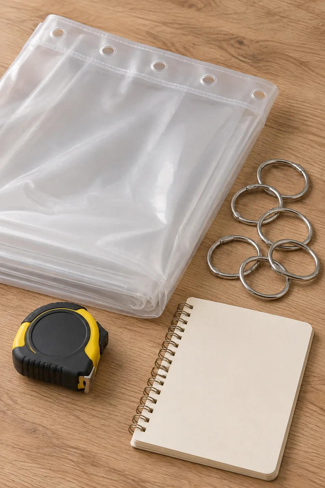

A replacement shower liner can be a small bathroom update until its hem lands in a different place or the top will not work with your rings. Before ordering, record the setup you have. Start with the liner, its attachment points, and the space it needs to cover.

This guide focuses on a tub-and-shower arrangement with an existing rod and separate liner. A snap-in liner, curved enclosure, or specialty track needs its own compatible replacement. Identify that system before choosing a generic sheet with hanging holes.

## Record what is already working

With the shower off and the area dry, photograph the top attachments and the liner's bottom position. Note any gap at either end, fabric bunching on the tub bottom, or difficulty sliding it open. Use a liner that works correctly as a reference. If the current one fits poorly, record the problem so you can correct it when comparing candidates.

Write down whether rings pass through individual holes, whether the liner snaps onto a curtain, or whether it uses another attachment. Count the attachment points. Check how the rings open and whether they carry both the decorative curtain and liner. A matching hole count is only one compatibility check. The holes and rings must also connect and move as intended.

Keep access to the controls and the route into the tub clear. If the rod is loose or damaged, have that problem addressed before hanging a replacement. In a rental, use our [permission request guide](/articles/ask-landlord-permission-rental-update/) if the proposed solution involves changing or moving hardware.

## Compare width and hanging drop separately

Record the opening the liner must cover and the existing liner's full width when laid flat. Compare those with the candidate's stated width and installation instructions. Look for enough coverage to close it as intended without pulling it taut. Check both ends in the actual opening, including where your rings stop along the rod.

For height, measure from a repeatable attachment reference to the hem. With a conventional hole-top liner, the center of a hanging hole is a useful starting point. Record where the bottom currently falls inside the tub, then compare the candidate from the same reference. Ask the maker for an unclear dimension.

A package's overall length includes the material above the hanging holes. Different hole positions or ring shapes can change the installed bottom position even when two packages list the same length. Keep the same rings when making a direct comparison, or account for the replacement attachment's different drop.

Product pages also vary in their stated dimensions. For example, IKEA lists its NÄLK liner at **71 inches wide and 71 inches long**, while Parachute lists its liner at **72 by 72 inches**. These are current specification-reading examples, not fit recommendations. Check the exact model's dimensions and instructions before ordering. [IKEA NÄLK measurements](https://www.ikea.com/us/en/p/naelk-shower-curtain-liner-clear-00626498/) and [Parachute liner details](https://parachutehome.com/products/shower-curtain-liner)

<figure class="article-inline-image">

<figcaption>Compare the top attachment as well as the sheet dimensions. This generated scene illustrates the planning supplies.</figcaption>
</figure>

## Work through a longer-liner example

Imagine the current liner has a **70-inch drop from the hole centers to the hem** and hangs where it should in this particular tub. A candidate has a **72-inch drop measured from that same reference**. On the same rings and rod, its bottom would hang **2 inches lower**.

In this hypothetical bathroom, that would put the hem onto the tub bottom. The renter looks for a more suitable liner instead of assuming that a longer sheet improves the fit. These dimensions illustrate the comparison and establish no universal clearance or recommended liner length.

## Copy a replacement worksheet

| Check | Existing setup | Candidate liner |
|---|---|---|
| Attachment type | Rings, snaps, or another system | Confirm compatible design |
| Attachment count and connection | Count and photograph | Check holes, spacing, and connection |
| Opening and width | Record opening and flat liner width | Read exact width and coverage directions |
| Hanging drop | Measure attachment reference to hem | Obtain the same measurement |
| Bottom and side positions | Photograph with liner closed | Check in place before normal use |
| Care instructions | Keep the current label if available | Read the exact new label |

Before buying a multipack, resolve every blank that affects compatibility. Keep the product name and care label in the same record. Our [home product manual guide](/articles/organize-home-product-manuals/) explains how to save instructions so you can find the right version again.

## Read the care directions before replacing it

Care instructions can differ substantially. IKEA's NÄLK page says not to wash, bleach, or tumble dry that liner. Parachute describes its polyester liner as machine washable. Use the care label and current instructions for the exact item you select. A cleaning method suitable for another liner may be unsuitable for yours. [IKEA liner care](https://www.ikea.com/us/en/p/naelk-shower-curtain-liner-clear-00626498/) and [Parachute details and care](https://parachutehome.com/products/shower-curtain-liner)

When you hang the new liner according to its instructions, check that the attachments close properly, the liner slides, and the bottom and sides sit as intended. IKEA describes its liner as the inner layer protecting the decorative curtain. Verify your chosen product's placement in your tub before normal use. If the only apparent fix is moving the rod, revisit the dimensions and rental requirements first.

For a broader bathroom update, our [narrow bathroom storage guide](/articles/narrow-bathroom-storage-fit-check/) checks door movement and access before you add a cart or shelf. Keep the liner replacement focused on a compatible item that works with the room's existing setup.
