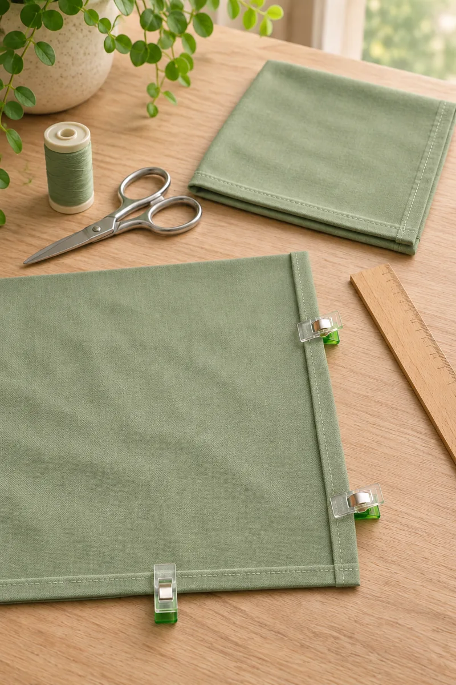

A fabric remnant may hold four useful napkins, two larger ones, or just one trial piece. Find out before cutting. Starting with the fabric's usable dimensions lets you choose a set you can actually finish.

This project uses a narrow double-fold hem and plain overlapping corners. You'll need a sewing machine you know how to use, matching thread, fabric scissors, a ruler, clips or pins, and an iron with a suitable pressing surface. The generated photographs illustrate the idea; they do not document napkins we made or tested.

## Prepare the fabric before deciding the size

Choose a washable woven fabric whose care requirements you know. [Folkwear's napkin project](https://www.folkwear.com/blogs/news/free-pattern-holiday-napkins) suggests lightweight to medium-weight cotton or linen and recommends washing and pressing before cutting. Follow the actual fabric's care and ironing directions. Preparation helps you plan around the material you will sew, without assuming a fixed shrinkage percentage.

For a first attempt, a stable plain-weave remnant makes the cutting lines and folds easier to see. Set aside badly worn cloth, unknown coated fabric, or a material whose intended care doesn't suit everyday table use. Thick fabric can make the small folded corners awkward, so try the hem on an offcut first.

After the cloth is dry and pressed, spread it flat. Exclude tight selvage edges, damaged patches, and uneven ends from the area you count. Measure the largest usable rectangle that follows the fabric's weave. Record width and length separately in inches. A shop label's original width or purchased yardage is not the same as this prepared rectangle.

## Add the hem allowance before drawing the squares

For this method, each edge turns inward **¼ inch, then another ¼ inch**. Each side uses ½ inch of the original cloth, so add **1 inch to both the finished width and finished length**.

A planned 15-inch finished napkin therefore starts as a 16-inch square. This calculation belongs to the hem described here; a wider hem needs a different allowance. [Janome's double-fold method](https://www.janome.com/inspire/projects/super-simple-cloth-napkins/)

Before choosing, fold an existing clean cloth to your proposed finished size and try it at a place setting and on your lap. Decide whether that size serves your routine. The largest possible square isn't automatically the most useful one.

Lay out the full cut squares on the fabric before cutting any. Paper squares can help compare options. Include space lost when straightening an edge or cutting around a flaw. With a directional print, keep the intended orientation consistent.

## Compare two plans for the same remnant

Imagine a prepared, usable rectangle measuring **40 × 33 inches**, with no damaged areas. These are hypothetical dimensions, not a claim about what remains from a purchased yard.

| Plan | Finished square | Cut square | Layout on 40 × 33 inches | Napkins |
|---|---|---|---|---|
| Larger pair | 16 × 16 inches | 17 × 17 inches | Two across, one row | 2 |
| Smaller set | 15 × 15 inches | 16 × 16 inches | Two across, two rows | 4 |

Two 17-inch rows would require 34 inches, exceeding the available 33. Two 16-inch rows need 32 inches. That one-inch change in the finished size makes a four-piece layout possible in this example.

The smaller layout occupies 32 × 32 inches. Its remaining strips are 8 inches along the width and 1 inch along the length, with their shared corner counted only once. Check the real fabric and your cutting accuracy before relying on a tight layout. If the folded size doesn't work for you, keep the larger pair rather than making four pieces you won't use.

## Sew one sample before the rest

Cut the first planned square, keeping the other squares marked and uncut. Check your machine manual for suitable needle, thread, foot, and threading instructions. Use an offcut to establish a straight seam before sewing the napkin.

Press each edge toward the wrong side by ¼ inch, then repeat the turn to enclose the raw edge. Keep the corners simply overlapped and square; Folkwear includes this alternative to mitering. Clip or pin the folds in place. [Square-corner reference](https://www.folkwear.com/blogs/news/free-pattern-holiday-napkins)

Stitch around the napkin close to the inner folded edge, catching the hem. Remove clips or pins before they reach the needle. At a corner, stop with the needle down, lift the presser foot, turn the cloth, then lower the foot and continue. Secure the seam ends using your machine's instructions. [Janome sewing reference](https://www.janome.com/inspire/projects/super-simple-cloth-napkins/)

<figure class="article-inline-image">

<figcaption>Check that the sample's folded edges are caught by the stitching. This generated scene illustrates a simple overlapping corner, not a measured sewing demonstration.</figcaption>
</figure>

## Check the sample and finish only the set you need

Measure the finished sample and inspect both faces. Look for an exposed raw edge, missed section of hem, or corner that hasn't been caught by the stitching. Correct those problems before repeating them on the rest. Put the sample through its intended care routine and check it again before finishing a larger batch.

Keep a short project note: prepared fabric dimensions, finished size, cut size, hem turns, planned quantity, and sample changes. Then cut and sew the remaining pieces using the revised plan.

Give the napkins a convenient spot near where you set the table. Our [small kitchen drawer plan](/articles/organize-small-kitchen-drawers/) can help assign that space. If you give a finished cloth as reusable gift wrapping, first check it with the actual box using our [fabric-square wrapping guide](/articles/wrap-boxed-gift-fabric-square/).
