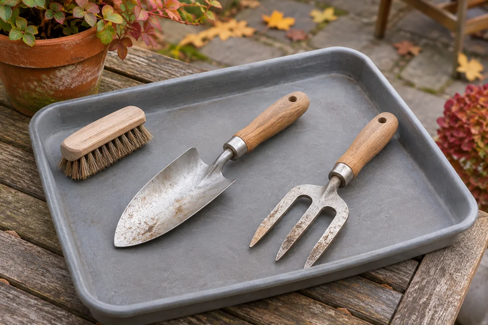

A patio gardening session often ends with an awkward choice: leave the muddy trowel outside or carry it through the house to a storage spot. A new tool bag may hold the equipment, but it does not answer where the soil comes off or where a washed tool finishes drying.

Plan the return trip before choosing a container. For a few short-handled tools, the useful arrangement has three jobs: a place to remove debris, a protected place for drying, and a dry storage home. These can be small temporary setups rather than three permanent stations.

This guide covers a modest hand-tool kit, such as a trowel, hand fork, and gloves. Powered equipment, batteries, fuels, and chemical products need their own instructions and storage arrangements.

## Start with the tools you actually carry to the pots

Gather the tools used for your ordinary container-garden tasks. Put duplicates and equipment awaiting repair in a separate decision group. Record a loose handle, damaged point, or another concern before returning a tool to the ready-to-use kit; follow the maker's repair or replacement guidance.

Lay the usable tools flat on a work surface. Notice the full length, handle thickness, and projecting tines. A narrow pocket that holds the handle may still leave the working end exposed. Keep any supplied guards and use them as directed. Choose storage that keeps pointed or cutting parts contained and prevents access by children or pets; an open shelf is unsuitable wherever it cannot do that.

Gloves deserve their own check. Read their care label, and plan a separate drying position if they become damp. Do not assume their washing or drying method is the same as the tools'.

## Decide where the debris comes off

Choose a permitted work area near the pots where you can manage soil and cleanup without blocking a door or shared walkway. A dedicated washable work tray may help contain loose debris. Check the tray material and cleaning instructions before repurposing something you own, and keep it for gardening afterward.

[Illinois Extension recommends putting tools away clean and dry](https://extension.illinois.edu/news-releases/proper-maintenance-extends-lifespan-saves-money-garden-tools) and keeping stored equipment away from ground moisture. Start by removing visible soil with a suitable brush, following the tool maker's cleaning directions. If washing is appropriate, plan the water access and cleanup before starting. Do not leave a trail of muddy water through the doorway to reach the storage shelf.

Check local or building rules for handling wash water and debris. A patio drain, neighboring planting area, or shared sink is not automatically an appropriate destination. If you cannot complete the cleanup in the proposed spot, change that part of the routine before buying a caddy.

## Give drying a real place in the plan

An empty storage box is not necessarily a drying area. After cleaning, follow the tool's drying instructions and check the handle, metal, joints, and any guard before packing it away. Do not close damp tools in a bag just to clear the work surface.

Choose a temporary position protected from rain, with the tools stable, separated, and inaccessible to children or pets. Keep it out of the walking route. If you use a tray, remove collected water and let the tray itself dry as well. A container that has just carried wet tools needs attention before becoming their dry storage home.

There is no universal waiting time in this plan. Weather, materials, and the cleaning method differ. The return condition is dry equipment, not a particular number of minutes. In a wet spell, an outdoor location that keeps getting rained on does not finish the job.

<figure class="article-inline-image">

<figcaption>Allow handling space around each tool. This generated illustration shows an arrangement, not proof that the tools are dry, disinfected, or ready for storage.</figcaption>
</figure>

## Keep cleaning separate from disinfection

[University of Minnesota Extension explains that soil and plant debris can transfer plant diseases](https://extension.umn.edu/garden-and-home/yard-and-garden/gardening-in-minnesota/how-to-clean-and-disinfect-gardening-tools-and-containers). A tool can look clean while pathogens remain. Its guidance calls for cleaning before disinfection and addresses occasions such as working with infected plants, moving between garden sites, and seasonal storage.

Use that guidance with the tool manufacturer's instructions and the exact disinfectant label when planning treatment. This storage arrangement does not disinfect anything. If disease is suspected or the appropriate treatment is unclear, keep the tool out of the ready kit and ask your local extension service. Do not improvise a chemical mixture or store treatment products inside the hand-tool tray.

## Try the complete return with an existing tray

Here is a hypothetical small-home example. One gardener uses a trowel, a hand fork, and one pair of gloves for three patio containers. An existing rigid tray can hold the two tools flat on a utility shelf, while the dry gloves have a separate spot beside it. The household can restrict access to this area; otherwise, a suitable secured storage location would be needed.

The first rehearsal reveals the actual problem: the gardener has a final shelf, but no protected drying spot after washing. Buying a fitted tool bag would leave that problem unresolved. The next step is to arrange drying and cleanup, then repeat the return before ordering anything.

Use this worksheet for your own kit:

| Part of the return | Record a specific place or condition | What would stop the plan? |
|---|---|---|
| Remove soil | Work surface, brush, and cleanup destination | Debris or wash water has nowhere appropriate to go |
| Dry tools and gloves | Protected position; item-specific care directions | Rain reaches it, or damp items must be packed immediately |
| Store the ready kit | Exact shelf or secured location; tools and guards contained | Points project, access cannot be controlled, or the location stays damp |
| Retrieve next time | Lift the filled tray and reach each handle | Another pile must move first, or the load is awkward to carry |

If buying a container becomes necessary, compare its usable interior with the whole kit and its exterior with the shelf and opening. Our [closet measurement guide](/articles/measure-closet-before-buying-organizers/) explains that distinction. A storage tray is a candidate only after a comfortable loaded carry and retrieval check; its advertised capacity cannot establish that for you.

## Leave seasonal maintenance as a separate task

At a longer seasonal break, review the exact tools' maintenance directions for rust, protective treatments, sharpening, or repairs. Do not assume that fitting everything in a tray completes that work. Keep an unresolved tool out of the ready kit until the required attention is complete.

For furniture, covers, and cushions, use the separate [small patio winter storage plan](/articles/small-patio-winter-storage-plan/). For living containers, follow the [potted-perennial winter guide](/articles/overwinter-potted-perennials-small-patio/). The hand-tool arrangement has a smaller job: let you finish gardening with the tools accounted for, dry, and stored in a place you can use again.
