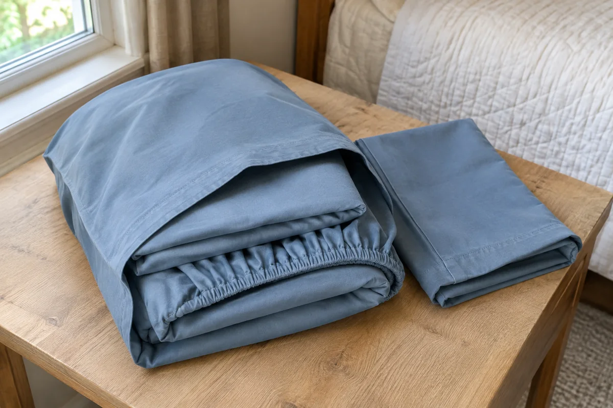

The linen shelf looks tidy until you take a fitted sheet to the wrong bed. Similar colors and compact folds can hide the one detail you need: where this set actually belongs. In a small home, that confusion also makes it hard to tell whether you need another set or just need to find the pieces you already own.

Start with one bed and its next change of sheets. Give the clean spare a recognizable home, keep its pieces together, and leave a way to return it after laundry. You can try the arrangement with an existing shelf and pillowcases before buying organizers.

## Name the bed before sorting the shelf

Write down each bed that needs sheets, including an occasional guest bed. Use a name another person would recognize, such as “main bedroom queen” or “office twin XL.” Two beds of the same size can share a supply if their sheets genuinely work on both; otherwise, separate their assignments.

Read the labels on the sheets rather than guessing from a folded rectangle. Saatva's size guide distinguishes twin from twin XL and notes that fitted-sheet depth matters as well as width and length. For an uncertain sheet, check its exact product information and confirm the fit on the intended mattress before calling it ready to use. A color is an identifier, not evidence of fit.

Keep care labels attached. If a label is missing, put the piece in a temporary “check” group and record what is unknown. Do not turn a guess into a permanent shelf label. This is a household sorting exercise, not a reason to buy replacements immediately.

## Define what counts as ready for your household

A usable change means the pieces you actually put on that bed. That might be a fitted sheet, a flat sheet, and two pillowcases; another household may not use a flat sheet. Write your own combination once, so a bundle does not look complete while a required pillowcase is elsewhere.

Look in three places before making a purchase list: the bed, the clean storage area, and the laundry. A set in the wash is unavailable right now, but it has not disappeared. Likewise, an empty shelf spot may simply mean its contents are on the bed.

Keep usable extra pillowcases in a separate, identified spot if they serve a purpose. They do not need to be forced into matching sets. Put pieces for a mattress you no longer own aside for a separate decision rather than letting them occupy the ready-to-use section.

## Bundle one change without making a tight package

Fold the needed pieces to a shape you can lift from your shelf. Au Lit Fine Linens suggests keeping a set inside one of its pillowcases and recommends a cool, dry, well-ventilated storage location. That existing pillowcase is a useful first container to try.

Slide the folded sheets and any other needed pillowcases loosely inside it. If the bundle is awkward to fill or remove, keep the pieces together in a small open stack instead. The method should make laundry easier to put away, not add a packaging job.

Leontine Linens recommends storing linens clean and thoroughly dry. Follow each item's care instructions, and leave damp items out of the storage bundle while they finish drying. If the proposed spot is damp or poorly ventilated, choose another location before organizing it.

<figure class="article-inline-image">

<figcaption>A pillowcase can keep pieces together without a new organizer. This generated illustration does not depict a tested household setup.</figcaption>
</figure>

## Give the bundle a home that explains itself

Assign a shelf section to the bed, then add a small shelf card with the bed name and size. If appropriate for the surface, a freestanding card avoids attaching anything to the cupboard. Keep it visible when the bundle is gone; it marks where the clean set returns.

Try removing one bundle without disturbing the neighboring group. Leave enough room to grasp it and put it back with ordinary folds. If every return requires squeezing and restacking, reduce what shares that section or choose a different location. Perfect folding should not be a requirement for using the system.

For a container purchase, [measure the closet opening and usable shelf space](/articles/measure-closet-before-buying-organizers/) first. Check the filled bundle as well as the bin's outside dimensions. Matching containers will not resolve an unclear bed assignment.

## A two-bed example and a worksheet to copy

Consider this hypothetical household: a queen bed used nightly and a twin XL used by guests. The queen has one set on the bed and one clean spare. The guest sheets are in the laundry after a visit. A third folded group contains a fitted sheet marked full, left from an old mattress.

The useful decision is to reserve a return spot for the guest set, not fill that apparent gap with the full-size sheet. The full-size piece stays outside the ready section until its future use is decided. This example illustrates a sorting decision; it does not prescribe how many sets every home should own.

| Bed or group | Pieces needed for one change | Where the pieces are now | Storage home / next action |
|---|---|---|---|
| Main bedroom queen | Fitted, flat, two pillowcases | One change on bed; one clean spare | Front-left shelf; label remains when empty |
| Office twin XL | Fitted, flat, one pillowcase | In laundry after guest visit | Front-right shelf; return here when clean and dry |
| Old full-size fitted sheet | No current bed assignment | Separate check group | Decide on a real use before returning to this shelf |
| Your bed: ___ | ___ | On bed: ___; clean: ___; laundry: ___ | Location: ___; unresolved detail: ___ |

Set your spare quantity around your actual laundry access, change routine, and guest needs. If the system leaves you without a clean change when you need one, record that specific gap before shopping. If it works, an empty portion of the shelf can stay empty.

## Check the return after the next wash

When the laundry is ready, rebuild the bed's bundle and return it to the marked section. Ask someone else to find the correct change using the shelf card. If they need you to explain which white stack is which, make the bed assignment clearer.

Keep decorative textiles separate from this everyday supply. For covers that belong to existing cushions, our [throw pillow cover guide](/articles/refresh-throw-pillow-covers-existing-inserts/) uses a separate size-and-care record. The sheet shelf has a narrower job: make the next bed change easy to identify and easy to put away.
