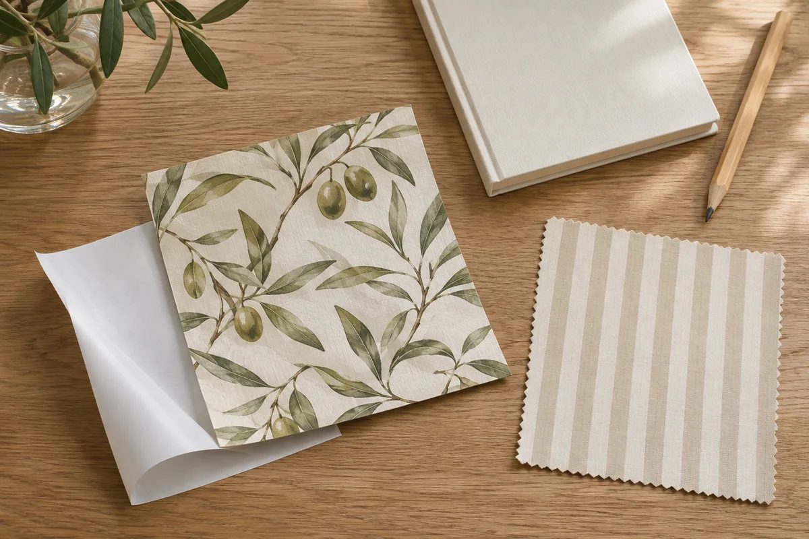

A wallpaper sample can answer two different questions: **Do I like the pattern here? Can this exact adhesive go on this exact wall?** You can answer the first without peeling off the backing. The second takes permission where applicable, compatible surfaces, and the manufacturer's testing and removal directions.

Start with one wall and one candidate product. You may learn enough to wait, choose a different product, or leave the wall alone before you buy a roll.

## Preview the pattern with the backing on

Hold the sample against the intended wall or prop it securely on a table in front of it. Look at it from the doorway and from the spot where you normally sit. Check it in daylight and with the lights you use after dark. Put a fabric or paint sample you intend to keep next to it if that will help you judge the combination.

A small swatch may show only part of a repeat. Look at the maker's full pattern view before deciding how dense or large the design will appear across the wall. If the color or pattern already feels wrong, stop here. You don't need an adhesive test to rule it out.

## Check the wall before touching the adhesive

Write down the wall surface, paint finish, paint date if known, and anything that makes the test spot different from the rest of the wall. The hidden strip behind a cabinet isn't representative if it has a different paint or texture. A finish that looks smooth in a photo isn't a confirmed paint type.

Read the instructions for the exact wallpaper and check the paint maker's cure directions if the wall was recently painted. [Tempaper](https://tempaper.com/pages/how-to-install-wallpaper), for example, recommends smooth, sound surfaces with a satin or semi-gloss finish and directs customers to the paint instructions for curing. [Spoonflower's peel-and-stick guide](https://www.spoonflower.com/en/learn/how-to/install-peel-and-stick-wallpaper) also lists eggshell among its preferred finishes, flags certain washable or no-VOC paints, and specifies a waiting period for fresh paint. These are product-specific requirements. Don't transfer one maker's list or timing to another wallpaper.

If the wall is damp, peeling, or otherwise damaged, leave it out of the project and address the underlying issue first. This guide does not cover scraping, sanding, stripping, or other surface repair. For rentals, ask specifically whether both the sample and any later installation are permitted. Our [rental update request guide](/articles/ask-landlord-permission-rental-update/) helps you put the location, product, and proposed removal in writing.

## Run a small test only if the wall and product qualify

Confirm that the sample uses the same wallpaper material and backing as the roll you would order. If it is a color-only swatch, it can help you judge appearance but can't test the adhesive.

If the maker recommends a test, choose an inconspicuous, representative spot you are allowed to use. Photograph the wall before starting. Follow the maker's directions for preparation, test duration, and removal. Ask the maker for clarification if its instructions don't say how to test your situation; don't make up a universal waiting period.

Note whether corners lift or bubbles appear, and photograph the sample before and after removal. Record what you actually see on both the paint and the back of the sample. If paint lifts or the finish changes, stop and ask about next steps rather than trying another spot or using a stronger cleaner.

<figure class="article-inline-image">

<figcaption>Record the product and backing before testing. This generated illustration does not show a tested wall or removal result.</figcaption>
</figure>

## Use a short decision record

| Check | What to record | Decision |
|---|---|---|
| Pattern and light | Sample design, daytime view, evening view | Keep as a candidate or rule it out |
| Surface and permission | Exact finish, cure status, compatible product instructions, permission | Test only when all are confirmed |
| Adhesion and removal | Test location, dates, lifting, residue, and paint changes | Stop if there is a problem; ask if the result is unclear |
| Full wall | Differences in finish, repairs, or texture outside the test area | Recheck differences before ordering |

Imagine a renter who likes a botanical pattern in daylight and under a lamp, but learns that the wall was repainted last week and the finish is unknown. They keep the design on their shortlist and leave the backing intact. The next step is to confirm the paint and its cure requirements and ask about permission for a test. They do not order rolls based on the color check alone.

Even an uneventful sample test is one observation on one part of a wall for a limited time. It does not predict what will happen to a whole installation months later. Before committing, use our [removal planning guide](/articles/plan-rental-update-removal-before-installing/) to record what must come off and what condition the wall should be left in. If you decide against adhesive, our [reversible living room guide](/articles/reversible-living-room-updates/) offers changes you can try with the wall untouched.
