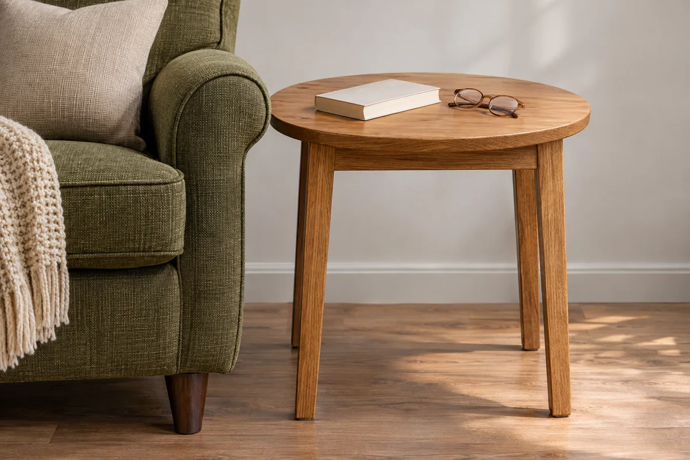

An empty corner can look like the obvious place for a reading chair. But the better location may be beside the sofa, where a usable light and side table already exist. Before buying a matching chair, lamp, and bookcase, try a corner with the seat you already use comfortably.

Make the first version small: **a seat, useful light, a place for the current book, and room to get in and out.** Then compare how it works on three ordinary reading occasions. The exercise is a household layout trial, not an ergonomic assessment or a tested furniture recommendation.

## Pick the reading habit before the corner

Write down what you expect to do here. Reading a paperback after dinner may require a different setup from sharing a picture book with a child or balancing a large illustrated book. Choose one main use for the first trial rather than furnishing for every possible reader.

Use the real book or device when you sit down. Notice whether you can settle into the chair without constantly moving the book, whether the arms get in your way, and whether you have a comfortable place for your feet. These are observations about your own use, not a reason to adopt someone else's seat dimensions.

If moving the chair would be difficult, try the reading session in its current position first and sketch the alternative location. Get appropriate help for heavy furniture; do not drag it around simply to complete this exercise. Our [living room refresh guide](/articles/reversible-living-room-updates/) offers a wider plan for changing a room one piece at a time.

## Check the corner with the chair occupied

An empty chair footprint misses the room you need to sit down and stand up. Include projecting legs and arms, any recliner movement the maker permits, and the route into the seat. Open nearby doors and drawers normally, without forcing them against furniture.

Keep exits, vents, and the household's walking routes clear. Check any required heater or appliance clearances against the actual equipment instructions. This guide does not provide universal clearance numbers or determine building compliance.

Ask someone who shares the room to use the usual route while you are seated. If they have to turn sideways, move the table repeatedly, or step over your things, reconsider the arrangement. A reading corner should not depend on the rest of the room stopping work.

## Look at the page at the time you intend to read

Try the light in the evening if that is when the corner will be used. A bright window at lunchtime does not tell you what the page will look like after dark. With your normal glasses and the actual reading material, note distracting reflections, shadows, or a bare light source in your line of sight. Adjust an existing lamp only within its intended range and use directions.

The [U.S. Department of Energy's office checklist](https://www.energy.gov/cmei/femp/office-energy-checklist) describes task lighting as directing light to the work area. Apply that general distinction when you compare the page with the room's decorative glow; the checklist is not a home reading-light specification. This trial does not establish a required brightness, bulb type, or health outcome.

Keep lamps stable and their controls reachable. Follow the lamp's bulb and operating instructions, and choose a location with a suitable reachable outlet and cable route. Do not solve placement by running a cord across a walkway or altering electrical equipment. If the existing location cannot support the lamp properly, leave lighting as an unresolved requirement before shopping.

If the lamp already suits the corner but needs a new shade, [measure the replacement shade and check its attachment](/articles/measure-replacement-table-lamp-shade/) before ordering. The fitter position affects where the lower rim sits in your line of sight.

## Give the side table one job

Clear a stable table you already own, then place only the things the reading session uses on it: the current book, glasses, or a cup if you want one. Try setting the book down and picking it up while seated. Move the table if you need an awkward twist or have to lean past another object. Keep drinks away from electrical equipment.

A table that holds a plant, lamp, and decorative stack may have little useful space left. Remove the optional objects before concluding that the table is too small. If an existing table is damaged, use our [side-table repair or replacement guide](/articles/repair-or-replace-side-table/) to decide what work it needs separately from the decorating plan.

<figure class="article-inline-image">

<figcaption>Try the reach with your own chair and table. This generated illustration does not establish a recommended table height or distance.</figcaption>
</figure>

## Record three ordinary reading sessions

Choose three occasions that resemble your actual routine. There is no required duration; the point is to notice repeated problems before buying another piece. Change one thing between sessions so you can tell what helped.

| Session | Arrangement and time | What got in the way? | One next adjustment |
|---|---|---|---|
| First | Existing chair in its usual place; evening | Record page lighting, reach, and route | Clear the table or change its position |
| Second | Same chair; one change only | Note whether that problem returned | Keep the change or reverse it |
| Third | Ordinary household activity nearby | Check shared route and returning the book | Write a specific remaining need |

If another person uses the seat, invite their own observations rather than assuming your result works for both of you. Keep any purchase list tied to those observations: “a stable surface I can reach from this chair” is more useful than “finish the nook.”

## Example: the decorative corner loses to the sofa end

Imagine someone trying an existing armchair in a visually empty corner. The chair fits on the floor, but the only workable lamp location would put its cable across a route. The reader rejects that arrangement instead of hiding the cord under a rug.

They return the chair to the sofa end, clear the existing side table, and try their usual evening reading. On the next session, they move the table slightly to improve access while keeping the route clear. On the third, they check the setup while someone else uses the room. In this hypothetical example, the smaller change meets the reader's needs, so a new chair and bookcase stay off the shopping list.

Your result may be different. If a purchase remains necessary, record the usable dimensions, operating requirements, and access it must preserve. Add a throw or cushion only after the basic arrangement works; our [pillow-cover guide](/articles/refresh-throw-pillow-covers-existing-inserts/) starts with the inserts you already own. The useful endpoint is a place you can read and reset easily, even when the rest of the room is busy.
