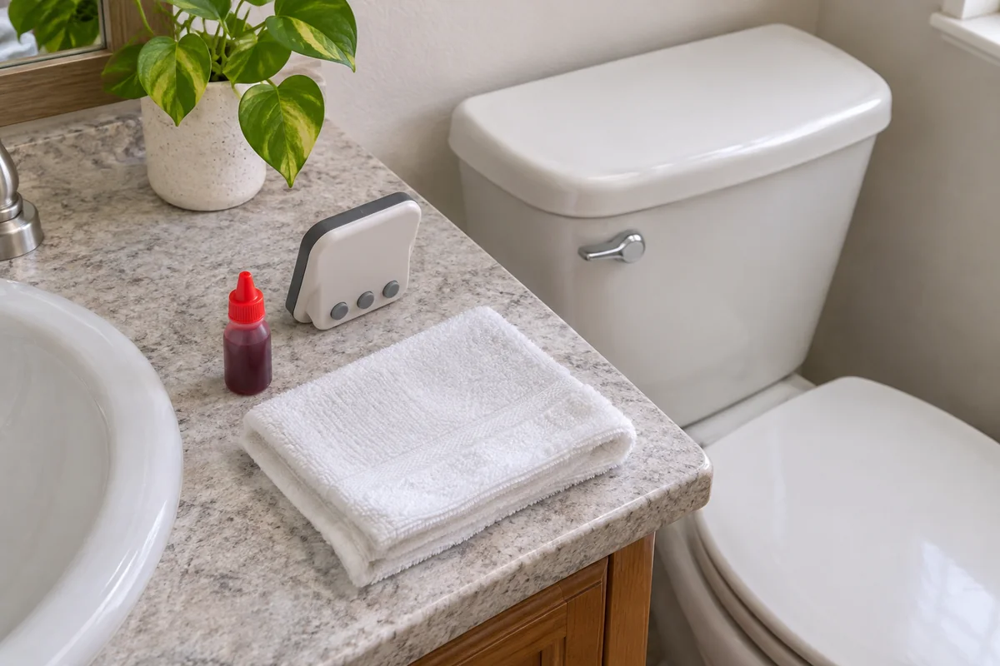

A toilet that refills between uses gives you something to report, but the sound alone gives maintenance little to work with. On a conventional toilet with an accessible gravity tank, a few drops of food coloring can show whether water moves from the tank into the bowl while nobody flushes.

Set aside ten minutes when the bathroom can stay unused. Keep a timer and a note handy so you can record the result and flush right away.

## Check the starting conditions

Use this method on a conventional gravity toilet with a removable tank lid and clear water in the tank and bowl. If you have a concealed tank, a pressure-assisted unit, or an unfamiliar design, check the model instructions or ask maintenance for the appropriate test. If water in either the tank or bowl is already tinted, or there is a cleaner in either one, postpone the dye test and follow the applicable product instructions.

Start after the tank has finished refilling. Look into the bowl under good light and note its starting appearance. If the fixture is overflowing, cracked, or leaking onto the floor, report that directly. The dye test addresses water moving into the bowl.

Lift the tank lid only if you can handle it comfortably. Set it flat on a towel on a stable surface out of the walking route. Keep the lid supported and avoid touching or moving the parts inside the tank.

<figure class="article-inline-image">

<figcaption>Gather the supplies before starting so you can check the bowl on time. This generated illustration depicts the preparation.</figcaption>
</figure>

## Add the color to the tank and set a timer

1. Put a few drops of liquid food coloring into the water in the **tank**.
2. Set a timer for ten minutes. Tell anyone sharing the bathroom to leave the toilet unflushed during the check.
3. At ten minutes, look at the bowl. Compare the water with the clear starting condition and note whether the dye color appeared.
4. Flush immediately after observing the result to reduce the risk of staining. Return the tank lid to its normal position carefully.

The quantity, timing, and prompt flush come from [EPA WaterSense's household leak guidance](https://www.epa.gov/watersense/fix-leak-week). The [WaterSense technical sheet](https://nepis.epa.gov/Exe/ZyPURL.cgi?Dockey=P10180T1.txt) also specifies observing the bowl without a flush during the wait.

## Write down what the test showed

**Color appeared in the bowl without a flush.** Report that water moved from the tank to the bowl during the check. A worn flush seal is one possibility. NYC's Department of Environmental Protection also describes other mechanisms, including a fill valve that allows water to enter the overflow tube. Have the cause checked before buying a replacement part. [NYC DEP toilet leak guidance](https://www.nyc.gov/site/dep/water/detecting-toilet-leaks.page)

**The bowl stayed clear.** Record “no color observed in ten minutes.” If you still hear unexplained refills, note when they happen and ask maintenance to investigate. Your observation describes that particular window of time.

**Someone flushed, or the starting water was already tinted.** Record the check as inconclusive. Try again only when both starting conditions and the uninterrupted wait can be confirmed.

| Record | Hypothetical example | Your toilet |
|---|---|---|
| Fixture and symptom | Hall bath. Brief refills between uses. | Room and observed symptom |
| Start and finish | 10:14 to 10:24 a.m. Bowl clear at the start. | Date, times, starting color |
| Observation | Pale blue in bowl at 10:24. No flush during wait. | Color or clear, and any interruption |
| Follow-up | Flushed at 10:24. Sent observation to maintenance. | When flushed and who will follow up |

A short report can read: “Hall bathroom toilet refills between uses. I added food coloring to the tank at 10:14 a.m. The bowl was clear at the start and pale blue after ten minutes without a flush. I flushed immediately afterward. Could you check the source?”

## Give the repair person the right information

If you rent, use the building's maintenance channel. Include the room, symptom, and timed observation. If you own the fixture, look up the model or contact a plumber for the next step. Our [guide to organizing product manuals](/articles/organize-home-product-manuals/) can help you match the instructions to the fixture you actually have.

Looking at a different kind of bathroom leak? Use the [under-sink storage guide](/articles/under-sink-storage-around-pipes/) to keep pipe joints and shutoffs visible and accessible for inspection.
