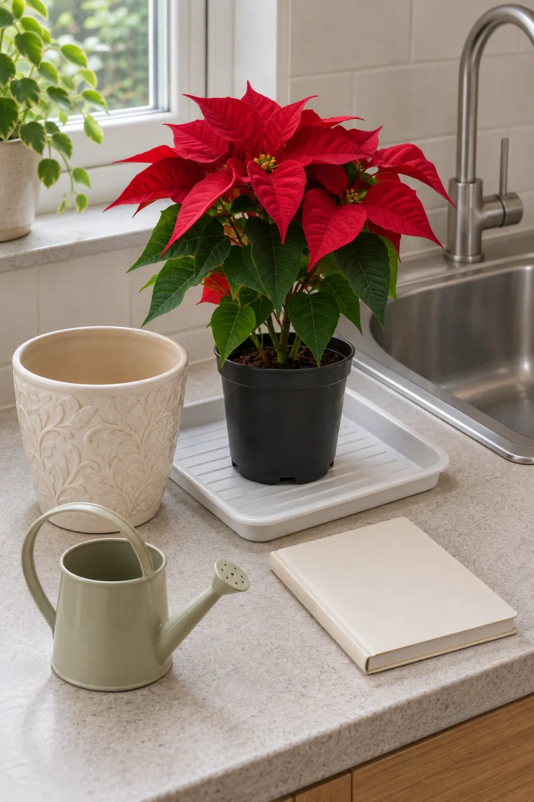

A poinsettia can arrive in a draining nursery pot hidden inside foil or a decorative container. Water may leave the inner pot and collect underneath it, where you cannot see it from above. Before choosing a watering day, check the complete container setup.

For a holiday display in a small home, plan two places for the plant: its everyday growing spot and a nearby place where you can water it and let it drain. Keep the trip between them clear so the task is easy to repeat.

## Look beneath the decorative cover

Support the nursery pot as you lift it out of the decorative container. Check that the inner pot has drainage openings and that you can remove it without pulling on the stems. Empty any water collected in the outer container or saucer.

Remove decorative foil or plastic wrapping that holds water around the pot. The U.S. Botanic Garden recommends unwrapping poinsettias because those covers retain water. University of Minnesota Extension likewise advises removing the outer pot before watering and using a pot that drains freely. [U.S. Botanic Garden care guide](https://www.usbg.gov/poinsettia-care) and [Minnesota Extension poinsettia guide](https://extension.umn.edu/garden-and-home/yard-and-garden/gardening-in-minnesota/poinsettia)

If the container arrangement is unclear, ask the nursery to identify the growing pot and show you how it should drain. Keep that information with the plant tag. A decorative cover should leave you able to inspect and handle the inner pot.

## Check the soil before adding water

Examine the soil daily. The Botanic Garden recommends watering when the soil surface feels dry to the touch. Minnesota Extension also uses surface dryness as a cue and cautions against allowing the plant to become so dry that it wilts. Check the soil itself instead of relying on the appearance of the red foliage or the date of the last watering. [Botanic Garden watering guidance](https://www.usbg.gov/poinsettia-care) and [Minnesota watering guidance](https://extension.umn.edu/garden-and-home/yard-and-garden/gardening-in-minnesota/poinsettia)

Use a daily reminder to inspect the plant. Let the observation determine whether you add water. Record a skipped watering just as clearly as a completed one, especially if someone else shares the care.

## Water where excess can drain away

Take the inner pot out of its outer container and place it in a sink. Water the soil gently and thoroughly until water runs through the drainage openings. Let it drain well before returning it to the display. Both the Botanic Garden and Minnesota Extension advise keeping the pot out of excess water. [Botanic Garden watering method](https://www.usbg.gov/poinsettia-care) and [Minnesota drainage advice](https://extension.umn.edu/garden-and-home/yard-and-garden/gardening-in-minnesota/poinsettia)

Use an empty saucer or outer pot when you return the plant. Check it for collected water after the move and empty it if needed. Protect the furniture with a suitable waterproof barrier, and wipe any drips from the pot and the surface. Allow yourself enough time to complete the draining and return steps in one session.

<figure class="article-inline-image">

<figcaption>Take the growing pot out of its decorative container for watering and drainage. This generated scene illustrates the setup.</figcaption>
</figure>

## Use a short care log

Imagine checking a poinsettia on three successive mornings. On the first morning, the soil surface still feels moist, so you leave the water alone. On the second, it feels dry, so you water at the sink, let the pot drain, and return it to an empty outer pot. On the third, the soil is still moist and you find a little collected water beneath the inner pot, which you empty.

This is a hypothetical record, not a three-day watering schedule. Your plant's observations may be different. The useful part is recording both soil condition and drainage so another person can see what happened.

| Check | Soil surface | Action | Outer pot or saucer |
|---|---|---|---|
| First morning, example | Moist | No water added | Empty |
| Second morning, example | Dry | Watered at sink; drained well | Empty before return |
| Third morning, example | Moist | No water added | Collected water emptied |
| Your date and time | Record what you find | Record what you did | Check and record |

Keep the note near your plant-care supplies. If the plant develops persistent wilting or other problems despite an appropriate routine, take photos of the plant, soil, and container arrangement to a local extension service or the nursery for advice.

## Keep the display workable

The Botanic Garden recommends bright light away from direct sun, drafts, cold window contact, and heat registers. Choose a suitable stable location where you can reach the soil and remove the pot. Our [indoor plant light guide](/articles/check-window-light-before-buying-houseplants/) helps you record conditions at the plant's actual position. [Botanic Garden location guidance](https://www.usbg.gov/poinsettia-care)

Keep the watering method specific to the plant and container. A [paperwhite bulb bowl](/articles/grow-paperwhites-in-pebbles-indoors/) uses a different setup and waterline, so give it a separate care record. For your poinsettia, finish each watering by checking that excess water has somewhere to go and that the display container is empty.
