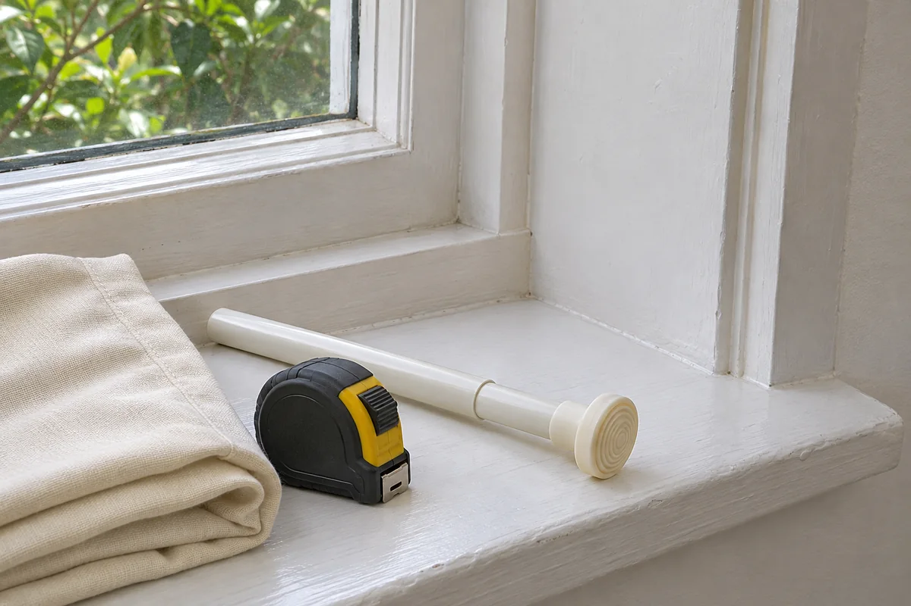

The size on a tension rod package answers one question: can the rod span an opening of that width? A rental window can pass that check and still have a narrow strip of trim under one pad or a handle that catches the curtain. Check the exact spot where the rod and fabric would sit before buying either one.

This guide is for a curtain rod designed to press between the two inside faces of a window recess. Start with one window and the curtain you intend to use.

## Find two places for the end pads

Stand in front of the window and choose the height and depth that would put the fabric where you need it. Locate the matching spots on the left and right jambs, the upright inside faces of the recess. In [Kenney's instructions for its room-darkening tension rod](https://www.kenney.com/_resources/common/userfiles/file/RD%20Tension%20Rod.pdf), the pads meet opposite sides of the inside casing. Use the instructions for your own model to confirm its contact surfaces.

Measure the span between those two spots. If you move the rod forward or back to clear a handle, take a fresh measurement. A step in the trim can change both the span and the flat area available to an end pad. Measuring across the decorative trim on the wall gives you a different number.

Record the uninterrupted flat area at both ends. Check the proposed pad dimensions and shape against that area. A paper template cut to the pad's actual size can help you see whether it crosses a rounded edge. Hold the template against each side without attaching it. If the pad dimensions or surface requirements are unavailable, ask the manufacturer before ordering. Skip crumbling trim, loose paint, and any location that cannot provide the contact called for by the instructions.

<figure class="article-inline-image">

<figcaption>Check the end pad against the flat part of the jamb at the intended rod position. The scene is an illustration.</figcaption>
</figure>

## Check the weight of everything you will hang

Check the product's opening range and load limit for the proposed setup. IKEA's [FJÄDRANDE instruction sheet](https://www.ikea.com/us/en/assembly_instructions/fjaedrande-curtain-rod-white__AA-2089147-2.pdf), for example, shows a 27½- to 47¼-inch range and a 4-pound maximum in the U.S. instructions. Use the directions supplied with your exact rod, including any conditions on its load rating.

Count both panels and any rings or clips the rod will carry. Weigh the items you already own or ask the seller for the total hanging weight. A product listing can describe the weight of a single panel or a shipping package, so confirm which number you have. Check that the chosen heading, such as a rod pocket, works with the rod and end hardware.

## Check the window with the fabric open and closed

Move the window through its normal range before installing anything. Watch the latch, crank or sliding sash. Then hold an existing fabric panel, or use a sketch of the fabric's occupied space, to see where it would hang when closed and bunch when open. You should still be able to reach and operate the hardware. Follow any clearance instructions for nearby heating equipment.

Keep escape windows clear. The [U.S. Fire Administration's escape planning guidance](https://www.usfa.fema.gov/prevention/home-fires/prepare-for-fire/home-fire-escape-plans/) calls for unobstructed windows and doors. If the rod or fabric could impede escape, choose another arrangement. For homes with young children, the [CPSC recommends cordless window coverings](https://www.cpsc.gov/safety-education/safety-guides/kids-and-babies/Childproofing-Your-Home?language=en).

## Use one measurement sheet for one window

Here is a hypothetical example. At the front of a rental window recess, a renter measures 34 inches between the jambs. The panel weighs 1 pound 10 ounces and the compatible rings add 6 ounces, giving 2 pounds total. Both numbers fall within the limits shown on the IKEA example sheet. At that position, though, a trim step leaves only ⅝ inch of uninterrupted flat area at one end. The renter cannot confirm that the pad will sit entirely on that area. Moving the rod farther in provides flatter contact but puts the fabric across the latch. The purchase stays on hold while the renter checks other options.

| Check | What to record for your window | When to pause |
|---|---|---|
| Span | Inside width at the proposed height and depth | Opening falls outside the exact model's range |
| Pad contact | Flat area and finish at each end, plus pad size | Pad would cross a trim step or surface suitability is unknown |
| Hanging weight | All panels, clips, and rings | Total exceeds the limit or either number is unknown |
| Daily operation | Latch, sash, screen access and fabric bunching | Hardware catches or an escape opening could be obstructed |
| Rental permission | Rules on coverings and any approval needed | Building requirements or contact with the finish remain unresolved |

## Confirm the rental details before mounting

Read the rules for the actual unit, including any requirements for window coverings visible from outside. If management needs to approve the change, send a photo of the two contact areas and the exact product instructions. Use our [guide to asking about a small rental update](/articles/ask-landlord-permission-rental-update/) to make the request specific.

Once the location and product match, follow the manufacturer's installation and removal directions. Check normal curtain and window movement with the actual fabric in place. If the rod shifts or the finish starts to lift, remove it as directed and reassess the setup. Save the instructions with a photo of the original window, as described in our [rental room documentation guide](/articles/document-rental-room-before-decorating/).
