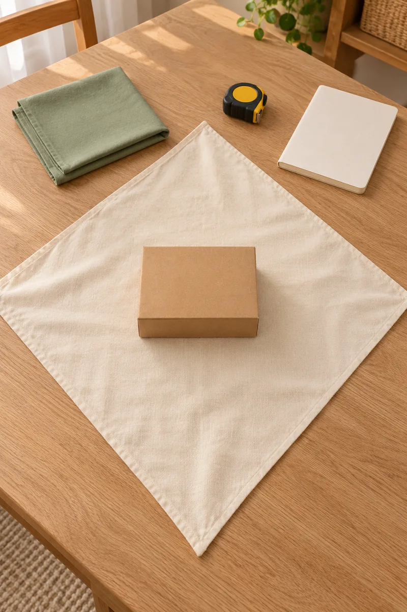

A fabric square can wrap a small gift and fold away afterward. Start with a clean scarf, napkin, or wrapping cloth you already own, then try it around the actual box before deciding to use it. The cloth needs enough reach for the folds and the knot, with a finish you are happy to give.

This project uses a simple method inspired by **furoshiki**, the Japanese practice of wrapping with cloth. Japan's Ministry of the Environment provides an illustrated guide that includes the basic **Otsukai Tsutsumi** wrap. Use the original diagrams alongside the steps below if you are new to the folds. [Official furoshiki wrapping guide](https://www.env.go.jp/en/focus/attach/060403-5.html)

## Choose the cloth and the box together

If you want to make a reusable cloth from a suitable fabric remnant, our [simple cloth napkin sewing guide](/articles/sew-cloth-napkins-fabric-remnant/) includes a cut plan and enclosed hems. Check the finished cloth with the actual box before deciding to use it as wrapping.

Use a closed, lightweight box for your first attempt. Keep fragile items protected inside their own suitable packaging. The cloth adds a presentation layer. Support the box from underneath when moving it.

Look for a square that lies flat and bends around the corners without a bulky pile of fabric on top. Check it for stains, snags, loose edges, or a care label that will end up in an awkward place. Follow the cloth's care instructions and let it dry completely before wrapping. Set aside a delicate or sentimental textile if you would be uncomfortable giving it away or creasing it.

Place the cloth on a clean, dry table and try it with the box. If it cannot cover the box and leave enough fabric to tie comfortably, choose a larger square or a smaller box. A very thick cloth may cover the box but make an oversized knot. A slippery scarf may be awkward to keep in position. Try the materials you have before shopping for a special wrap.

## Fold two corners and tie the other two

Eirakuya's basic wrapping method covers the item with two opposite corners and joins the remaining pair with a square knot. Its illustrated knot guide also shows how to alternate the crossings. [Eirakuya wrapping and knot instructions](https://www.eirakuya.jp/view/page/furoshiki_how_to_en)

1. Spread the cloth with its decorative side facing down. Arrange it like a diamond, with one corner toward you and one pointing away. Center the box on the cloth.
2. Bring the near corner up over the box. Smooth the cloth around the edge, then bring the far corner over it. Fold or roll excess fabric inward so it rests neatly on top.
3. Gather the left and right corners and bring them together above the box. Keep the folds in place while you check that the ends have enough reach.
4. Tie a square knot. Cross the right end over the left and pass it underneath, then cross the left end over the right and pass it underneath. Gently draw both ends outward and arrange the tails.

If the ends barely meet, unwrap and change the cloth or box instead of pulling hard on the fabric. Check the underside and corners for exposed areas. Untie and refold a loose or bulky section before adding the tag.

<figure class="article-inline-image">

<figcaption>Try the actual box and cloth together before making the final folds. This generated scene illustrates the setup.</figcaption>
</figure>

## Make a short fit record

Imagine a **6-by-4-by-2-inch box** and two cloth squares already in a drawer. In this hypothetical trial, a **20-inch square** covers the box but leaves ends that are awkward to tie. A **24-inch square** gives the person enough reach for a comfortable knot, so that is the one they choose.

These are example observations, not a sizing formula. Fabric thickness, stretch, box shape, and your folds all affect the result. Record a successful pairing if you expect to use the same box again.

| What to record | Your trial |
|---|---|
| Box length, width, and height | Measure in inches |
| Cloth side length and identity | Record the actual square you used |
| Coverage | Check top, bottom, and corners |
| Knot and folds | Enough reach; manageable bulk; stays arranged |
| Final decision | Use this pairing, try another cloth, or choose another package |
| After opening | Recipient keeps cloth or returns it by agreement |

## Make reuse easy for the recipient

Decide whether the cloth is part of the gift before presenting it. A short note can say, “The cloth is yours to keep and reuse,” or you can agree in advance that it will come back to you. Lush describes both giving the cloth with the gift and keeping it, and explains that cloth wrapping can be undone and tried again without cutting or tape. [Lush introduction to knot wrapping](https://www.lush.com/us/en_us/a/introduction-to-knot-wraps)

Add a tag beneath the knot or use another attachment that will not damage the fabric. Keep any care instructions available. Fold unused squares together so they are ready for the next gift, and return borrowed household linens to their usual place.

Our [pack-away gift-wrapping kit guide](/articles/pack-away-gift-wrapping-kit/) can help you keep the cloths, tags, and other supplies together. If the kit needs a shelf, use the [closet measurement guide](/articles/measure-closet-before-buying-organizers/) to check both storage space and room to lift it out. One successful cloth-and-box pairing is enough for a first project.
